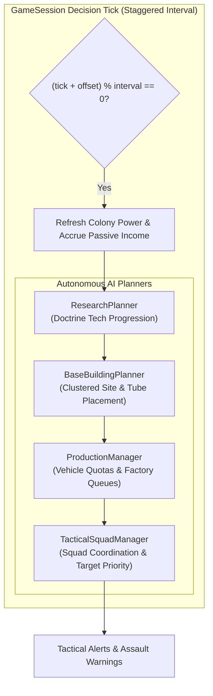

# Outpost 2 — Tactical AI Personalities & Skirmish Autonomy Specification

## 1. Overview & Subsystem Architecture

In *Outpost 2: Divided Destiny*, skirmish matches and campaign bot encounters are powered by the **Tactical AI & Skirmish Autonomy Subsystem** (`src/sim/ai.rs`). This architecture models genuine rival colony commanders capable of independent base layout planning, resource logistics management, tech tree progression, factory fabrication queueing, and coordinated multi-squad tactical strikes.

The AI system is modularly decomposed into four autonomous planning engines coordinated through the master `AiPlayer` loop:

---

## 2. Strategic Personalities & Faction Doctrines

Every computer opponent operates under a distinct `AiPersonality`, governing economic priorities, vehicle chassis ratios, weapon loadouts, and military combat stances:

### A. Aggressive Rusher (Plymouth Doctrine)
* **Strategic Intent:** Overwhelm the opponent before advanced shields, heavy fortifications, or end-game armor can be researched.
* **Chassis Distribution:** 65% Lynx Scouts / Light Tanks, 25% Panther Battle Tanks, 10% Tiger Heavy Tanks.
* **Preferred Weaponry:** Microbial Acid Clouds (`#22c55e`), Microwave Thermal Emitters (`#facc15`), and Pulse Lasers (`#00d4ff`).
* **Tactical Doctrine:**
  - Fast strike squads mobilize as soon as 3 combat units assemble.
  - Dedicated Harassment Wings aggressively hunt down human player Cargo Trucks and unescorted Robo-Miners.
  - Relentless focus on unshielded infrastructure, power lines, and ConVecs to freeze opponent base expansion.
* **Tech Priority:** Lynx Reinforced Armor (`5104`) $\to$ Pulse Laser Optics (`5202`) $\to$ Hyper-Velocity Railguns (`5301`).

### B. Defensive Fortifier (Eden Doctrine)
* **Strategic Intent:** Build an impenetrable defensive bastion, expand geothermal energy, secure choke points with Guard Post turrets, and assemble massive armored divisions for crushing counter-attacks.
* **Chassis Distribution:** 15% Lynx Scouts, 50% Panther Battle Tanks, 35% Tiger Heavy Tanks.
* **Preferred Weaponry:** Hyper-Velocity Railguns (`#e2e8f0`), High-Energy Pulse Lasers (`#00d4ff`), and RPGs (`#f97316`).
* **Tactical Doctrine:**
  - Deploys up to 4 perimeter Guard Post defense turrets linked via pressurized tube conduits.
  - Keeps military units anchored to base perimeter defense until a critical mass of 6+ heavy tanks is ready.
  - Damaged units rigorously disengage at 40% HP to seek nano-repair at Vehicle Repair Depots.
* **Tech Priority:** Automated Point Defense Turrets (`5401`) $\to$ Geothermal Extraction (`4301`) $\to$ Lava Containment Walls (`4201`) $\to$ Hyper-Velocity Railguns (`5301`).

### C. Economic Tech Rusher
* **Strategic Intent:** Maximize common and rare ore extraction, establish multiple research universities/laboratories, beeline down the technology tree, and deploy elite late-game armored divisions.
* **Chassis Distribution:** Early-game pure logistics (Cargo Trucks & Robo-Miners); late-game 45% Panthers, 35% Tigers with Railguns, 20% Lynx Scouts.
* **Preferred Weaponry:** Hyper-Velocity Railguns, Pulse Lasers, and EMP Disruption Arcs.
* **Tactical Doctrine:**
  - Guarantees immediate Robo-Miner deployment and continuous ore freight shuttle shuttling.
  - Builds up to 3 research laboratories (D.I.R.T. Labs and Standard Labs) to accelerate tech unlocks.
  - Launches tactical assaults only after key military robotics technologies have been researched or when base integrity is threatened.
* **Tech Priority:** Basic Lab (`2106`) $\to$ High-Temperature Smelting (`3402`) $\to$ Hydroponics Automation (`3301`) $\to$ Geothermal Plants (`4301`) $\to$ Railguns (`5301`) $\to$ Cryogenic Evacuation (`6101`).

### D. Custom Doctrine (`AiPersonality::Custom(AiConfig)`)
Allows players and scenario designers to configure custom bot parameters:
* `rush_preference`: `0.0` (passive) to `1.0` (hyper-aggressive).
* `defense_bias`: Weight allocated to perimeter Guard Posts and wall enclosures.
* `tech_focus`: Urgency of laboratory construction and tech investment.
* `economic_expansion_weight`: Prioritization of mining deposits and freight logistics.
* `min_strike_squad_size`: Custom mobilization threshold.

---

## 3. Subsystem Architecture

### Subsystem 1: Base Building Planner (`BaseBuildingPlanner`)
* **Colony Clustering:** Structures are clustered within a configurable radius (default: 18 tiles) around the colony hub `(base_x, base_y)` to form an authentic, cohesive base footprint.
* **Energy Deficit Assessment:** Continuously calculates net power ($P_{net} = P_{produced} - P_{consumed}$). If $P_{net} < 50\text{ kW}$, the planner immediately schedules Solar Power Arrays or Geothermal Power Plants (if researched).
* **Spiral Site Clearance:** Explores concentric Manhattan rings outward from base center:
  1. Validates tile bounds (`tx, ty` within map borders with safe buffer).
  2. Ensures non-lava terrain (`!tile.is_lava`) and non-obstructed ground (`!tile.is_wall_or_building`).
  3. Enforces 1-tile clearance buffers between existing buildings to allow pressurized transport tube conduits.
* **Automated Tube Conduit Routing:** Automatically connects newly erected installations to the nearest friendly building using orthogonal Manhattan tube routing (`connect_with_tubes`).

### Subsystem 2: Production Manager (`ProductionManager`)
* **Logistics Precondition:** Verifies that active ore deposits have at least 1 working Robo-Miner and 2 Cargo Trucks before spending minerals on heavy combat hulls.
* **Factory Queue Management:** Interacts directly with friendly `VehicleFactory` buildings in `session.buildings`, injecting unit fabrication requests into `production_queue` when idle and deducting ore costs from the AI stockpiles.
* **Support Vehicles:** Automatically queues Mobile Repair Vehicles once combat fleets reach 3+ tanks, providing active battlefield triage.
* **Specialized Weapon Mounts:** Fabricates doctrine-specific variants, including `Lynx (Microwave)`, `Lynx (Acid Cloud)`, and `Tiger (Railgun)`.

### Subsystem 3: Tactical Squad Manager (`TacticalSquadManager`)
* **Squad Formations:** Idle military units are grouped into operational wings:
  - `StrikeSquad`: Primary assault force targeting enemy bases and high-value infrastructure.
  - `HarassmentWing`: Fast raiders targeting player logistics routes and isolated ore haulers.
  - `PatrolWing`: Reconnaissance vehicles cycling perimeter waypoints.
  - `BaseDefense`: Heavy escorts anchored to the Command Center and Guard Posts.
* **High-Value Target Acquisition Matrix:** Evaluates detected hostile units and structures using a weighted priority scoring formula:
  $$\text{Score} = (\text{Base Priority} \times 10) - \text{Manhattan Distance}$$

| Target Type | Base Priority | Tactical Justification |
|:---|:---:|:---|
| **ConVec (Construction Vehicle)** | **95** | High priority: Prevents player base expansion and turret erection. |
| **Cargo Truck (Ore Logistics)** | **90** | Critical priority: Cripples player smelting income and factory output. |
| **Robo-Miner (Active Mine)** | **85** | Halts subterranean ore extraction. |
| **Command Center** | **80** | Eliminates player command hub and radar coordination. |
| **Power Plants (Solar / Geothermal)** | **75** | Induces colony brownouts, disabling player factories and guard posts. |
| **Ore Smelters** | **70** | Cuts refined metals production. |
| **Vehicle Factory** | **65** | Prevents battlefield reinforcements. |
| **Guard Post Turrets** | **60** | Breaches perimeter defenses. |
| **Combat Tanks** | **50** | Standard military engagement. |

* **Damaged Unit Retreat & Nano-Repair:**
  - Damaged units continuously check their health ratio:
    $$\frac{HP}{MaxHP} \le \text{Threshold}$$
  - Units falling below the threshold immediately break off engagement and pathfind back to the nearest friendly `Vehicle Repair Depot`.
  - Once healed back to operational levels, units are seamlessly reassigned to active combat squads.

### Subsystem 4: Research Planner (`ResearchPlanner`)
* **Laboratory Detection:** Validates that at least one D.I.R.T. Lab or Standard Research Lab is active and powered.
* **Doctrine Beeline:** Follows strict personality queues:
  - Aggressive Rusher: `5104` (Armor) $\to$ `5202` (Lasers) $\to$ `5301` (Railguns).
  - Defensive Fortifier: `5401` (Guard Posts) $\to$ `4301` (Geothermal) $\to$ `4201` (Walls) $\to$ `5301` (Railguns).
  - Economic Tech Rusher: `2106` (Basic Lab) $\to$ `3402` (Smelting) $\to$ `3301` (Hydroponics) $\to$ `4301` (Geothermal) $\to$ `5301` (Railguns) $\to$ `6101` (Cryo Stasis).
* **Resource Deduction:** Checks `common_ore >= tech.cost` and deducts cost upon research completion.

---

## 4. Difficulty Scalers Matrix

The AI difficulty setting dynamically scales decision cadences, starting stockpiles, resource yields, and combat aggressiveness:

| Difficulty Parameter | Easy | Medium | Hard |
|:---|:---:|:---:|:---:|
| **Decision Interval** | 60 ticks (~3.0 s) | 45 ticks (~2.25 s) | 30 ticks (~1.5 s) |
| **Starting Resources (Common, Rare)** | (1,200, 300) | (2,200, 600) | (3,500, 1,200) |
| **Resource Multiplier** | $0.85\times$ | $1.00\times$ | $1.35\times$ |
| **Repair Retreat Threshold** | 25% HP | 40% HP | 55% HP |
| **Aggression Multiplier** | $0.70\times$ | $1.00\times$ | $1.40\times$ |
| **Factory Queue Cooldown** | 50 ticks | 35 ticks | 20 ticks |

---

## 5. Multi-AI Skirmish Architecture & Staggered Ticks

* **1 to 5 AI Skirmish Support:** `ColonyState::setup_skirmish` allows full sandbox skirmishes supporting between 1 and 5 autonomous AI commanders competing against human players or each other.
* **Frame Hitch Elimination via Staggered Tick Offsets:**
  Each AI player is assigned a deterministic tick offset based on its unique player ID:
  $$\text{Offset} = (\text{AI ID} \times 11) \pmod{\text{Interval}}$$
  Decision loops only fire when:
  $$(\text{Current Tick} + \text{Offset}) \pmod{\text{Interval}} = 0$$
  This spreads pathfinding and site selection calculations evenly across consecutive frames, guaranteeing smooth 60 FPS performance even in 6-player skirmishes.
* **Multi-Faction Grid Integration:**
  - AI Guard Posts detect the faction of approaching units and open fire on hostiles while ignoring allies.
  - AI Cargo Trucks correctly route mined minerals to friendly smelters and credit ore to the respective AI commander's reserves.
  - Friendly Repair Depots radiate repair nanite beams exclusively to allied vehicles.

---

## 6. Verification & Test Suite Coverage

The AI subsystem is backed by comprehensive unit tests in `src/sim/ai.rs`:

1. `test_personality_initialization`: Verifies doctrine attributes, weapon preferences, and hull ratios for all personalities.
2. `test_production_quotas`: Tests vehicle selection progression from initial logistics (Robo-Miners, Cargo Trucks) to specialized combat tanks.
3. `test_building_placement_site_selection`: Confirms isometric footprint validation, non-collision with existing structures, and cluster radius adherence.
4. `test_tactical_squad_assault_logic`: Validates automatic squad assembly, high-value target acquisition (targeting ConVecs/Trucks), and attack order assignment.
5. `test_damaged_unit_retreat_to_repair`: Verifies that critically damaged units break off engagement and pathfind directly to repair depots.
6. `test_research_planner_progression`: Asserts tech queue beeline progression and ore budget validation.
7. `test_multi_ai_staggered_ticks`: Verifies distinct, non-overlapping tick execution offsets across multiple AI instances.
8. `test_difficulty_scalers`: Tests progression of parameters across Easy, Medium, and Hard difficulty levels.
9. `test_skirmish_setup_with_multiple_ai`: Verifies end-to-end skirmish match initialization with 3 distinct AI opponents and subsequent simulation updates.
