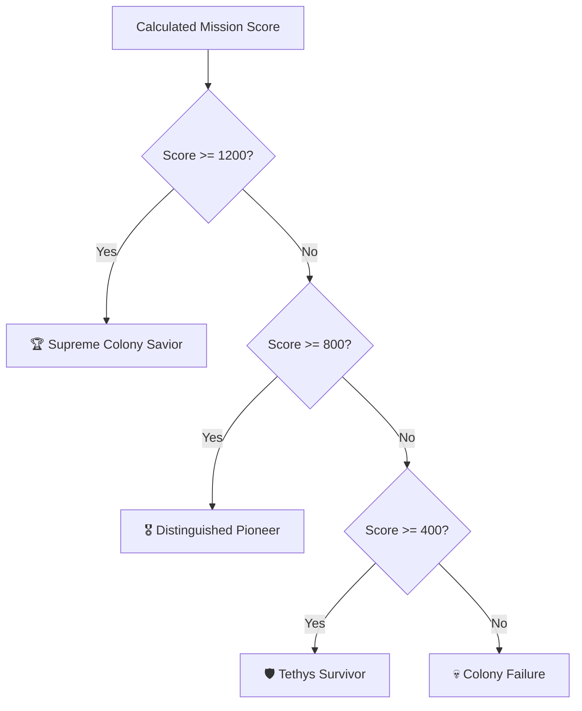

# Outpost 2: Divided Destiny — Campaign Progression & Mission Debriefing

## 1. Overview
The modernized Outpost 2 campaign progression captures the full narrative arc of the exodus from Earth to the harsh alien world of Tethys. Players command either the scientific **Eden** faction aiming to build and launch an orbital colony evacuation starship, or the militaristic **Plymouth** faction fighting for planetary survival, atmospheric terraforming, and total domination.

---

## 2. Campaign Mission Matrix

| Mission | Faction | Title | Canonical Map | Primary Objectives | Special Hazards & Events |
| :--- | :--- | :--- | :--- | :--- | :--- |
| **Eden 1** | Eden | *A New Dawn: Settlement & Survival* | `eden01.map` | Establish base, mine 500 ore, sustain 100 colonists | Proximity reconnaissance, early dust devils |
| **Eden 2** | Eden | *Molten Fissure Containment* | `eden02.map` | Contain advancing lava flow, construct 2 Geothermal Plants | Active volcanic magma expansion, Plymouth harrying raiders |
| **Eden 3** | Eden | *Escape From Mount Vulcan* | `eden03.map` | Assemble 4 Starship modules, evacuate 150 colonists via Evacuation Transports | Southern canyon volcanic breach, heavy Plymouth armor divisions |
| **Plymouth 1**| Plymouth | *Rebellion in the Canyons* | `ply01.map` | Establish mining outpost, produce 3 Lynx tanks | Scorched badlands, localized seismic tremors |
| **Plymouth 2**| Plymouth | *Smelter Sabotage & Ambush* | `ply02.map` | Infiltrate mineral ridge, eliminate Eden convoys | Guard Post perimeter turrets, laser defenses |
| **Plymouth 3**| Plymouth | *Operation Phoenix: Obsidian Crags Assault* | `ply03.map` | Protect Atmospheric Terraformer, breach Eden Obsidian Citadel | Spreading microbial blight contagion, railgun Tiger battle tanks |

---

## 3. Mission Debriefing & Colonial Scoring System

At the conclusion of every tactical scenario, the engine calculates a composite **Colonial Performance Rating** based on survival duration, economic throughput, technological superiority, tactical casualty ratios, and civilian preservation.

### Mathematical Formulation
$$\text{Score} = \text{Base} + S_{\text{eco}} + S_{\text{tech}} + S_{\text{combat}} + S_{\text{civ}} + S_{\text{obj}}$$

Where:
- $S_{\text{eco}} = \lfloor \frac{\text{Common Ore Mined}}{100} \rfloor \times 5 + \lfloor \frac{\text{Rare Ore Mined}}{50} \rfloor \times 10$
- $S_{\text{tech}} = \text{Techs Researched} \times 50$
- $S_{\text{combat}} = (\text{Enemy Kills} \times 25) - (\text{Friendly Losses} \times 40)$
- $S_{\text{civ}} = (\text{Surviving Civilians} \times 15) - (\text{Casualties} \times 50)$
- $S_{\text{obj}} = \begin{cases} 500 & \text{if Primary Victory Achieved} \\ 0 & \text{if Colony Failed / Defeated} \end{cases}$

### Rank Classifications

---

## 4. End-Game Cinematic Sequences & Audio Dispatches

### Victory Sequence
- **Eden Campaign**: When all 4 starship modules (Command Module, Habitat Ring, Cryo Stasis Bay, Ion Thruster) reach 100% completion and evacuation quotas are satisfied, the Starship launch ignition fires.
  - **Audio Dispatch**: Plays university research fanfare (`uni_grad.wav`) and launches the orbital trajectory animation.
- **Plymouth Campaign**: When the Eden Obsidian Citadel is neutralized and the Atmospheric Terraformer achieves 100% saturation, the terraforming bubble stabilizes.

### Defeat Sequence
- If the colony Command Center falls, critical casualty thresholds are exceeded, or essential structures are consumed by lava:
  - **Audio Dispatch**: Kathy Cullis voice event #227 (`savnt227.wav`): *"You have failed, our colony is doomed"*.
  - Visual breach indicators flash across the tactical command HUD.
