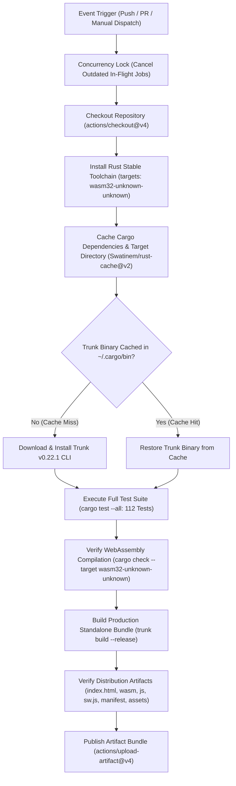
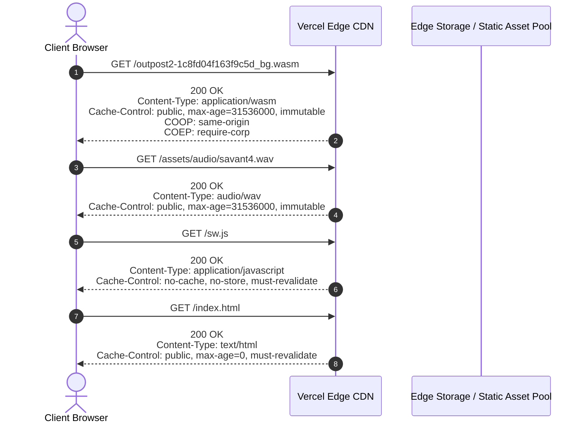

# Outpost 2: Divided Destiny — CI/CD Pipeline Hardening & Production Cloud Deployment Architecture

## 1. Executive Summary

This specification establishes the automated Continuous Integration and Continuous Deployment (CI/CD) pipeline hardening and Edge CDN cloud deployment architecture for *Outpost 2: Divided Destiny*. 

To deliver a zero-latency, cross-platform real-time strategy (RTS) experience across modern desktop and mobile web browsers, the project compiles high-performance Rust into **WebAssembly (`wasm32-unknown-unknown`)**, packages static bundles using **Trunk**, and serves them globally via an Edge Content Delivery Network (e.g., **Vercel Edge Network**).

Key engineering pillars established in this deployment system:
1. **Automated GitHub Actions CI Hardening (`.github/workflows/ci.yml`)**: Continuous multi-stage validation executing on every push to `main` and pull request, encompassing Rust toolchain setup, layered crate/tool caching, execution of all 112 unit and integration tests, WebAssembly compilation checks, and Trunk release bundling.
2. **Production Edge CDN Configuration (`vercel.json`)**: Deterministic header rules establishing Cross-Origin Isolation (`COOP` and `COEP`), proper `.wasm` MIME type binding (`application/wasm`), aggressive immutable caching for content-addressed static bundles, and zero-cache policies for service workers and application shells.
3. **PWA Atomic Delivery**: Zero-drift synchronization between Trunk build outputs, service worker lifecycle (`sw.js`), and edge caching headers.

---

## 2. GitHub Actions CI/CD Pipeline Architecture



### 2.1 Workflow Triggers & Concurrency Management

The pipeline is triggered automatically on all code integrations:
- `push`: Triggered on direct merges or commits to the `main` branch.
- `pull_request`: Triggered on open, synchronize, or reopen actions targeting `main`.
- `workflow_dispatch`: Enables manual on-demand pipeline execution with custom parameters.

To prevent CI resource congestion and race conditions when developers push rapid sequential commits, concurrency groups cancel redundant in-flight builds:

```yaml
concurrency:
  group: ${{ github.workflow }}-${{ github.ref }}
  cancel-in-progress: true
```

### 2.2 Layered Caching Hierarchy

WebAssembly compilation and tool installation can introduce significant latency in CI environments. The pipeline implements a two-tier caching strategy:

1. **Cargo Crates & Compilation Target Cache (`Swatinem/rust-cache@v2`)**:
   - Caches `~/.cargo/registry`, `~/.cargo/git`, and the workspace `target/` directory.
   - Automatically derives cache keys based on `Cargo.lock` hashing, compiler version, and system architecture.
   - Preserves intermediate build artifacts across steps, accelerating subsequent `cargo check` and `trunk build` operations.
2. **Trunk Executable Cache (`actions/cache@v4`)**:
   - Caches the precompiled `trunk` binary under `~/.cargo/bin/trunk`.
   - Keys on the Trunk release version and runner OS (`trunk-v0.22.1-${{ runner.os }}`).
   - Avoids repetitive GitHub Release tarball downloads on every pipeline execution.

### 2.3 Automated Test Suite Execution

The test suite runs prior to WebAssembly compilation to catch logical regressions early:

```bash
cargo test --all --verbose
```

The suite validates:
- **108 Unit Tests**: Sound bank parsing, audio gain routing, i18n string dictionaries, multiplayer lobby handshakes, network serialization, HUD math, touch input gestures, AI personalities, mission objective graphs, procedural map generator symmetry, and save-game serialization.
- **4 End-to-End Integration Tests**: State persistence roundtrip, WebRTC lockstep synchronization, multi-bot skirmish autonomy, and full campaign mission lifecycles.
- **Total Passing Tests**: **112 passing / 0 failing**.

### 2.4 WebAssembly Compilation Verification

Compiling Rust for the web target requires strict compatibility without standard POSIX threading or native platform syscalls. The pipeline runs:

```bash
cargo check --target wasm32-unknown-unknown --verbose
```

This enforces that all dependencies, math libraries, and game simulation modules conform cleanly to the 32-bit WebAssembly specification with zero compiler warnings.

### 2.5 Standalone Release Bundling & Distribution Verification

Trunk packages the client web application using configuration from `index.html` and `Trunk.toml`:
- Embeds the optimized `.wasm` binary (`data-wasm-opt="s"`).
- Emits content-addressed, revision-hashed files (e.g., `outpost2-[hash]_bg.wasm`, `outpost2-[hash].js`).
- Copies static PWA files (`manifest.json`, `sw.js`, `icons/`, `assets/audio/`).

The workflow rigorously verifies all output deliverables in `dist/`:

```bash
test -f dist/index.html
test -f dist/manifest.json
test -f dist/sw.js
test -d dist/icons
test -d dist/assets/audio
ls -la dist/*.wasm
ls -la dist/*.js
```

---

## 3. Production Edge CDN Headers & Vercel Architecture

Deploying modern browser game engines at the edge requires specific HTTP headers to satisfy WebAssembly security primitives, audio latency requirements, and progressive caching.



### 3.1 Cross-Origin Isolation (COOP & COEP)

Outpost 2 requires cross-origin isolation enabled globally on `/(.*)`:

```json
{
  "key": "Cross-Origin-Opener-Policy",
  "value": "same-origin"
},
{
  "key": "Cross-Origin-Embedder-Policy",
  "value": "require-corp"
}
```

#### Why Cross-Origin Isolation is Critical
1. **SharedArrayBuffer Access**: Modern web browsers mandate COOP/COEP to unlock `SharedArrayBuffer` memory sharing between the main UI thread and Web Workers (used for multi-threaded simulation, pathfinding calculations, and procedural terrain generation).
2. **Sub-Millisecond High-Precision Clocks**: Security defenses against Spectre side-channel attacks clamp `performance.now()` precision to $100\mu\text{s}$ or coarser in non-isolated contexts. With COOP/COEP enabled, browser engines restore sub-microsecond timer resolution ($5\mu\text{s}$), essential for frame-accurate 60 FPS RTS simulation and audio synthesis scheduling.
3. **Hardware Acceleration & Worklet Execution**: Enables dedicated audio worklets and offscreen canvas acceleration without cross-origin script leakage.

### 3.2 WebAssembly MIME Type Binding

Browsers strictly enforce that WebAssembly binaries streamed via `WebAssembly.instantiateStreaming` must carry the standard media type:

```http
Content-Type: application/wasm
```

Serving WebAssembly with generic types such as `application/octet-stream` or `text/plain` triggers runtime instantiation failures in Firefox, Chrome, and Safari. `vercel.json` guarantees explicit `application/wasm` routing across all `.wasm` endpoints.

### 3.3 Tiered Caching & Invalidation Matrix

| Asset Route Pattern | Target Resources | Cache-Control Header | Invalidation Strategy |
| :--- | :--- | :--- | :--- |
| `/(.*).wasm` | Compiled WebAssembly binary | `public, max-age=31536000, immutable` | **Content-Addressed Hashing**: New builds yield unique filenames (e.g., `outpost2-[hash]_bg.wasm`), safely cached for 1 year. |
| `/outpost2-(.*).js` | Generated JS runtime loader | `public, max-age=31536000, immutable` | **Content-Addressed Hashing**: Unique hash per compilation. |
| `/snippets/(.*)` | Trunk wasm-bindgen helpers | `public, max-age=31536000, immutable` | **Content-Addressed Hashing**: Trunk generates unique path hashes. |
| `/assets/audio/(.*)` | 96-sample PCM sound bank | `public, max-age=31536000, immutable` | **Static Asset Storage**: Immutable audio samples are cached permanently on CDN edge nodes and client disk. |
| `/icons/(.*)` | PWA UI icons (192x192, 512x512) | `public, max-age=31536000, immutable` | **Brand Static Media**: Permanent edge cache. |
| `/manifest.json` | Web App Manifest | `public, max-age=86400, must-revalidate` | **Daily Expiry**: 24-hour cache allows prompt rollout of app metadata updates. |
| `/sw.js` | Service Worker Script | `no-cache, no-store, must-revalidate` | **Immediate Invalidation**: The browser checks the byte identity of `sw.js` on every navigation. Must never be cached. |
| `/(index.html)?` | HTML Shell & Retro Layout | `public, max-age=0, must-revalidate` | **ETag Revalidation**: Immediate propagation of updated bundle hashes to end users. |

### 3.4 Defense-in-Depth Security Headers

To protect players and prevent clickjacking, MIME sniffing, and referrer leaking, the edge configuration enforces:

```json
{ "key": "X-Content-Type-Options", "value": "nosniff" },
{ "key": "X-Frame-Options", "value": "SAMEORIGIN" },
{ "key": "Referrer-Policy", "value": "strict-origin-when-cross-origin" }
```

---

## 4. Local Verification & Reproducibility Runbook

Engineers can execute the exact CI/CD pipeline locally to verify changes prior to opening pull requests:

### Step 1: Run Full Automated Test Suite
```bash
cargo test --all
```
*Expected Result:* 112 passed, 0 failed, 0 warnings.

### Step 2: Verify WebAssembly Target Compilation
```bash
cargo check --target wasm32-unknown-unknown
```
*Expected Result:* Clean exit with status 0, 0 warnings.

### Step 3: Compile Standalone Release Web Bundle
```bash
trunk build --release
```
*Expected Result:* Trunk generates distribution files in `dist/` with optimized `.wasm` binary and copied assets.

### Step 4: Verify Distribution Deliverables
```bash
test -f dist/index.html && \
test -f dist/manifest.json && \
test -f dist/sw.js && \
test -d dist/icons && \
test -d dist/assets/audio && \
ls -la dist/*.wasm && \
ls -la dist/*.js && echo "Verification Succeeded!"
```

### Step 5: Test Locally with Edge CDN Headers
```bash
trunk serve --release --port 8080
```
Navigate to `http://127.0.0.1:8080` in Chrome or Firefox. In DevTools Network tab, verify that responses include `Cross-Origin-Opener-Policy: same-origin` and `Cross-Origin-Embedder-Policy: require-corp`.
