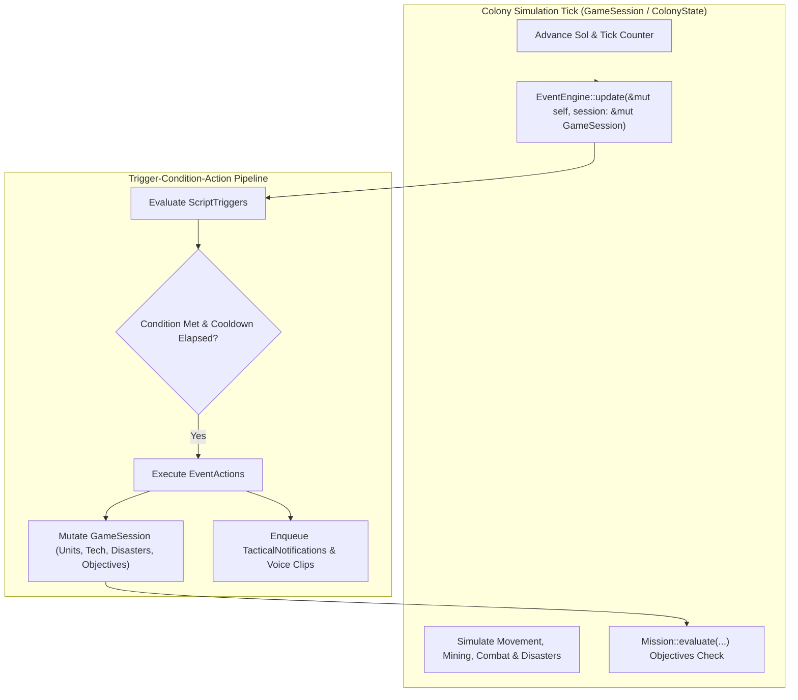

# Outpost 2 — Dynamic Event Engine & Mission Scripting Architecture

## 1. Overview & Architecture

The Outpost 2 native Rust engine incorporates an authentic, extensible **Dynamic Event Engine & Mission Scripting Subsystem** (`src/sim/events.rs`). This system provides tactical campaign scripting, ambient planetary hazards, dynamic story dispatches, hostile ambush sequencing, emergency reinforcement drops, and reactive objective state management.

The architecture decouples simulation mechanics from campaign narrative logic via a reactive **Trigger-Condition-Action (TCA)** design:



---

## 2. Trigger Data Model (`ScriptTrigger`)

Each scripted event is encapsulated within a `ScriptTrigger` struct containing identity, condition preconditions, action payloads, and execution cadence metadata:

```rust
#[derive(Debug, Clone, PartialEq, Serialize, Deserialize)]
pub struct ScriptTrigger {
    pub id: u32,
    pub name: String,
    pub condition: TriggerCondition,
    pub actions: Vec<EventAction>,
    pub fired: bool,
    pub repeatable: bool,
    pub cooldown_ticks: u32,
    pub last_fired_tick: u32,
}
```

### Lifecycle Semantics:
1. **One-Shot Triggers (`repeatable == false`):**
   - Fires exactly once when `condition.evaluate(session)` yields `true`.
   - Sets `fired = true` and `last_fired_tick = current_tick`.
   - Inactive on subsequent ticks regardless of state.
2. **Repeatable Triggers (`repeatable == true`):**
   - After initial trigger firing, enters a cooldown state.
   - Re-evaluates only when `current_tick.saturating_sub(last_fired_tick) >= cooldown_ticks`.
   - Allows recurring planetary sensor scans, ambient hazard bursts, or periodic militia reinforcement waves.

---

## 3. Trigger Conditions (`TriggerCondition`)

`TriggerCondition` represents composable telemetry queries evaluated against `&GameSession`:

| Variant | Parameters | Evaluation Logic | Canonical Tactical Use Case |
| :--- | :--- | :--- | :--- |
| `SolTimer(u32)` | `threshold: u32` | `session.sol >= threshold as f64 \|\| session.tick_count >= threshold as u64` | Narrative mission briefings, timed hostile strikes, volcanic phase changes. |
| `UnitInArea` | `unit_type: Option<UnitType>`, `x_min`, `y_min`, `x_max`, `y_max` | Any alive unit inside bounding box (matching `unit_type` if specified) | Canyon ambushes, hydrothermal resource discovery, base perimeter intrusion. |
| `StructureDestroyed(u32)` | `building_id: u32` | Building removed from active buildings or marked in `destroyed_building_ids` | Command Center loss, forward Guard Post collapse, factory demolition. |
| `ResourceThreshold` | `metal_min: Option<u32>`, `food_min: Option<u32>` | Stockpiles meet or exceed common/rare ore and/or food targets | Stockpile quotas, emergency supply shipments, starship assembly goals. |
| `CasualtiesExceeded(u32)` | `threshold: u32` | `session.casualties >= threshold` | Emergency reinforcement drops, mission failure triggers, desperate defense. |
| `CompoundAnd` | `Vec<TriggerCondition>` | `conditions.iter().all(\|c\| c.evaluate(session))` | Multi-step requirements (e.g. Sol > 5 AND unit in canyon). |
| `CompoundOr` | `Vec<TriggerCondition>` | `conditions.iter().any(\|c\| c.evaluate(session))` | Alternative triggers (e.g. Ore goal reached OR enemy base leveled). |

---

## 4. Event Actions (`EventAction`)

When a script trigger fires, its associated actions execute sequentially against the simulation session:

### 4.1 `SpawnReinforcements`
Spawns one or more units of a specified chassis type for either `Faction::Eden` or `Faction::Plymouth` at target coordinates:
```rust
EventAction::SpawnReinforcements {
    faction: Faction,
    unit_type: UnitType,
    count: usize,
    x: i32,
    y: i32,
}
```
Supported `UnitType` chassis:
- **`Lynx`:** Fast scout tank (`hp: 140`, `weapon: Laser`)
- **`Panther`:** Medium battle tank (`hp: 250`, `weapon: Railgun`)
- **`Tiger`:** Heavy assault tank (`hp: 350`, `weapon: Railgun`)
- **`CargoTruck`:** Automated ore freighter (`hp: 150`, logistics hauler state)
- **`ConVec`:** Modular construction vehicle (`hp: 180`)
- **`RepairVehicle`:** Field maintenance vehicle (`hp: 180`)
- **`Earthworker`:** Terrain engineering bulldozer (`hp: 200`)
- **`RoboMiner`:** Autonomous subsurface mining rig (`hp: 160`)
- **`EvacuationTransport`:** Colonist cryogenic transport shuttle (`hp: 220`)

### 4.2 `TriggerDisaster`
Instantiates immediate planetary natural hazards on New Terra:
- **`DisasterType::SeismicFissure`:** Ignites a 3x3 molten lava channel, creates planetary tremors, and triggers earthquake screen shake.
- **`DisasterType::AtmosphericVortex`:** Spawns a high-velocity dust vortex with a 25-second lifespan that damages structures and vehicles.
- **`DisasterType::MeteorImpact`:** Enqueues an orbital kinetic impactor with blast radius detonation damaging colonial tubes and units.
- **`DisasterType::MicrobialBlight`:** Infects the designated cellular coordinate with nanite blight spores that creep across adjacent terrain.

### 4.3 `UnlockTechnology`
Unlocks scientific disciplines in the `TechTree` directly (e.g. `2701` Astronomy, `3402` High-Temperature Smelting, `4201` Advanced Railguns).

### 4.4 `TacticalNotification`
Dispatches priority-coded advisory records to the HUD notification queue:
```rust
#[derive(Debug, Clone, PartialEq, Eq, Serialize, Deserialize)]
pub struct TacticalNotification {
    pub title: String,
    pub message: String,
    pub priority: NotificationPriority, // Low, Medium, High, Critical
}
```

### 4.5 `ModifyObjective`
Transitions objective states dynamically (`Pending`, `Active`, `Completed`, `Failed`). If a primary objective fails, `MissionStatus::Defeat` triggers automatically.

### 4.6 `PlayVoiceClip`
Queues legacy voice dispatch samples (`eden_01_briefing.wav`, `red_alert.wav`, `savant4.wav`) for radio broadcast playback.

---

## 5. Authentic Campaign Mission Scripts

The Event Engine includes preconfigured script trigger sets for canonical Outpost 2 scenarios:

### 5.1 Scenario 0: Eden Mission 1 — "Operation New Dawn"
- **Trigger 101 — High Council Dispatch (`SolTimer(1)`):**
  - **Action:** Tactical notification outlining survival priorities; queues `eden_01_briefing.wav`.
- **Trigger 102 — Hydrothermal Basin Discovery (`UnitInArea(30..45, 15..30)`):**
  - **Action:** Notifies colonial logistics of hydrothermal ore deposits in the eastern canyon.
- **Trigger 103 — Plymouth Badland Ambush (`UnitInArea(42..58, 10..25)`):**
  - **Action:** Spawns 2 Plymouth `Lynx` scout tanks at `(52, 15)`; triggers red alert siren and critical warning.
- **Trigger 104 — Eden Emergency Reinforcements (`CasualtiesExceeded(2)`):**
  - **Action:** Eden Command deploys 1 emergency `Panther Battle Tank` at `(22, 22)` to protect the Command Center.
- **Trigger 105 — Ore Stockpile Target (`ResourceThreshold { metal_min: Some(3000) }`):**
  - **Action:** Marks Objective 1 (`Stockpile 3,000t Common Ore`) as `Completed`.

### 5.2 Scenario 1: Plymouth Mission 1 — "Operation Badland Vanguard"
- **Trigger 201 — Plymouth Vanguard Dispatch (`SolTimer(1)`):**
  - **Action:** Directs Plymouth commanders to reject Eden technocracy and construct an autonomous Vehicle Factory.
- **Trigger 202 — Railgun Tech Breakthrough (`UnitInArea(Panther, 14..20, 22..28)`):**
  - **Action:** Unlocks Tech `4201` (Railguns) upon rolling out the first armed battle tank from the factory bay.
- **Trigger 203 — Eden Recon Intercepted (`UnitInArea(40..58, 30..50)`):**
  - **Action:** Spawns 2 Eden `Lynx` scouts at `(50, 38)` attempting to survey Plymouth geothermal power lines.
- **Trigger 204 — Badland Militia Response (`CasualtiesExceeded(2)`):**
  - **Action:** Local guerilla pilots deploy 2 `Lynx` scouts at `(18, 24)` to reinforce the frontline.

### 5.3 Scenario 3: Eden Mission 2 — "Operation Caldera Bastion"
- **Trigger 301 — Subsurface Magma Rupture (`SolTimer(2)`):**
  - **Action:** Triggers `DisasterType::SeismicFissure` at caldera coordinates `(22, 16)`; sounds planetary tremor siren.
- **Trigger 302 — Caldera Rotary Vortex (`UnitInArea(20..32, 12..22)`):**
  - **Action:** Spawns `DisasterType::AtmosphericVortex` at `(26, 18)` swirling outward through canyon passes.
- **Trigger 303 — Plymouth Geothermal Raid (`SolTimer(4)`):**
  - **Action:** Spawns 2 Plymouth `Panther` heavy tanks at `(48, 20)` attacking the geothermal power conduit rim.

### 5.4 Scenario 4: Plymouth Mission 2 — "Operation Iron Fang"
- **Trigger 401 — Ambush Choke Point Briefing (`SolTimer(1)`):**
  - **Action:** Advises Plymouth strike squadrons to entrench inside canyon bottleneck passes.
- **Trigger 402 — Eden Smelter Convoy Entry (`UnitInArea(28..42, 20..35)`):**
  - **Action:** Spawns 2 Eden `CargoTruck` haulers and 1 `Panther` escort at `(36, 24)` entering the ambush killzone.
- **Trigger 403 — Smelter Sabotage Ore Quota (`ResourceThreshold { metal_min: Some(3500) }`):**
  - **Action:** Marks Objective 3 as `Completed`; announces colonial mineral independence.

---

## 6. Simulation Integration & Execution Loop

The simulation loop integrates dynamic events seamlessly within `ColonyState::update`:

```rust
// 1. Increment simulation tick telemetry
self.tick_count = self.tick_count.wrapping_add(1);
self.sol += dt_secs * 0.05;

// 2. Track casualties and building eliminations in live combat
if target.hp == 0 && target.faction == self.faction {
    self.casualties += 1;
}

// 3. Advance Dynamic Event Engine
let mut engine = std::mem::take(&mut self.event_engine);
engine.update(self);
self.event_engine = engine;

// 4. Evaluate Campaign Mission Objectives against updated session state
let mission_alert = self.mission.evaluate(
    self.common_ore,
    self.rare_ore,
    self.power_produced,
    self.power_consumed,
    self.tubes.len(),
    self.morale_pct,
    &self.buildings,
    &self.units,
    &self.tech_tree,
);
```

---

## 7. Unit Testing & Verification

Comprehensive unit tests in `src/sim/events.rs` validate all trigger and action mechanics:

1. **`test_sol_timer_trigger`:** Validates that Sol-based triggers remain dormant before threshold, fire upon reaching Sol telemetry, and obey one-shot execution.
2. **`test_unit_in_area_trigger_and_reinforcement_spawning`:** Validates spatial bounding box detection, chassis type filtering (`UnitType::Panther`), unit ID sequential generation, and reinforcement attribute correctness.
3. **`test_casualties_exceeded_and_objective_modification`:** Validates casualty counting, trigger invocation upon threshold, dynamic objective state mutation (`ObjectiveStatus::Failed`), and heavy tank reinforcement creation.
4. **`test_compound_conditions`:** Validates boolean logic composition (`CompoundAnd`), ensuring actions only fire when all nested preconditions evaluate to `true`.
5. **`test_repeatable_trigger_cooldown`:** Validates repeatable triggers with explicit cooldown tick intervals, verifying multiple firings spaced by configured delay cadences.
