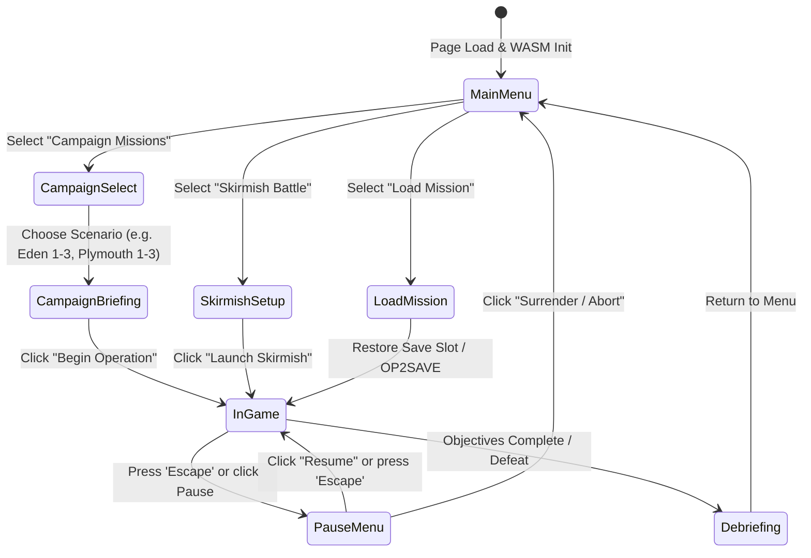

# Outpost 2 — End-to-End Game Polish, Audio Integration & Web Release Specification

## Overview

This specification documents the end-to-end integration pass for the web-native WebAssembly port of **Outpost 2: Divided Destiny**. It defines the audio dispatch architecture, high-DPI responsive canvas scaling formulas, smooth menu screen transitions, and production release build verification.

---

## 1. Audio Event Dispatch Architecture

Outpost 2 utilizes a dual-tier audio architecture:
1. **Digital Sound Bank (`SoundBank`)**: Preloads and caches decoded 8-bit mono unsigned PCM waveforms extracted directly from original Sierra `sound.vol` and `voices.vol` archives.
2. **Audio Manager (`AudioManager`)**: Orchestrates high-level simulation triggers, procedural synthesis fallbacks, volume attenuation, and radio channel routing.

### 1.1 Audio Event Dispatch Table

| Event Trigger | Audio File | Legacy ID | Channel Type | Audio Transcript / Description | Fallback Behavior |
| :--- | :--- | :---: | :--- | :--- | :--- |
| **Cargo Truck / Transport Selection** | `truk_sel.wav` | 56 | Unit Ack | *"Cargo truck selected"* | Procedural D5 chime (587.33 Hz) |
| **Earthworker / Dozer Selection** | `dozr_sel.wav` | 43 | Unit Ack | *"Earthworker bulldozer selected"* | Procedural D5 chime |
| **Medium Tank (Panther) Selection** | `combmed.wav` | 55 | Unit Ack | *"Panther medium combat vehicle selected"* | Procedural D5 chime |
| **Light Tank (Lynx) Selection** | `comblit.wav` | 54 | Unit Ack | *"Lynx light combat vehicle selected"* | Procedural D5 chime |
| **Heavy Tank (Tiger) Selection** | `combhev.wav` | 53 | Unit Ack | *"Tiger heavy assault vehicle selected"* | Procedural D5 chime |
| **Scout / Surveyor Selection** | `scout.wav` | 52 | Unit Ack | *"Scout vehicle selected"* | Procedural D5 chime |
| **Repair Vehicle Selection** | `repvhc.wav` | 49 | Unit Ack | *"Repair vehicle selected"* | Procedural D5 chime |
| **Robo-Miner Selection** | `robmine.wav` | 50 | Unit Ack | *"Robo-miner vehicle selected"* | Procedural D5 chime |
| **Colony Under Attack** | `savant4.wav` | 97 | Voice Dispatch | *"We are under attack!"* | Speech synthesis dispatch (15s cooldown) |
| **Structure Destroyed** | `savant3.wav` | 96 | Voice + SFX | *"Structure destroyed"* | Big explosion detonation (`bigexp1.wav`) |
| **Vehicle Destroyed** | `savnt206.wav` | 104 | Voice + SFX | *"Vehicle destroyed"* | Big explosion detonation (`bigexp1.wav`) |
| **Volcanic Eruption Surge** | `savant68.wav` | 138 | Voice + SFX | *"Danger: Volcanic eruption detected"* | Red alert siren + quake tremor (`quake.wav`) |
| **Atmospheric Vortex Spawn** | `savant71.wav` | 141 | Voice + SFX | *"Warning: Atmospheric vortex detected"* | Whistling howling wind synth (`tornado2.wav`) |
| **Scientific Breakthrough** | `savant2.wav` + `uni_grad.wav` | 95 + 58 | Voice + Fanfare | *"Research completed"* + Chime Fanfare | Multi-harmonic pentatonic arpeggio |

### 1.2 Vehicle Selection Dispatch Resolution

The `play_vehicle_selection` dispatcher inspects the active unit's semantic classification and routes to the authentic PCM sample:

```rust
pub fn play_vehicle_selection(&self, unit_name: &str) {
    if self.muted { return; }
    let lower = unit_name.to_lowercase();
    let sample = if lower.contains("earthworker") || lower.contains("dozer") {
        "dozr_sel.wav"
    } else if lower.contains("repair") {
        "repvhc.wav"
    } else if lower.contains("miner") || lower.contains("robmine") {
        "robmine.wav"
    } else if lower.contains("scout") || lower.contains("surveyor") {
        "scout.wav"
    } else if lower.contains("tiger") || lower.contains("heavy") {
        "combhev.wav"
    } else if lower.contains("panther") || lower.contains("medium") {
        "combmed.wav"
    } else if lower.contains("lynx") || lower.contains("light") {
        "comblit.wav"
    } else {
        "truk_sel.wav"
    };

    if self.bank.is_sample_loaded(sample) {
        self.bank.play_sample(sample);
    } else {
        self.play_unit_ack();
    }
}
```

---

## 2. High-DPI Responsive Viewport Recalibration

### 2.1 Viewport Scaling Formulas

To eliminate blurring, stretching, or subpixel shimmering on Retina, Apple Silicon, 4K, and high-DPI displays, the backing buffer dimensions are decoupled from CSS logical viewport coordinates:

$$\text{physical\_width} = \lfloor \text{client\_width} \times \text{dpr} \rceil$$
$$\text{physical\_height} = \lfloor \text{client\_height} \times \text{dpr} \rceil$$

Where:
- $\text{client\_width}, \text{client\_height}$: CSS logical dimensions rendered by the browser layout engine.
- $\text{dpr} = \max(1.0, \text{window.device\_pixel\_ratio()})$.

### 2.2 Pixel Boundary Snapping

To prevent anti-aliasing interpolation on 2.5D isometric tile edges and HUD vector bounds:

$$\text{snap}(x, \text{dpr}) = \frac{\lfloor x \times \text{dpr} \rceil}{\text{dpr}}$$

### 2.3 Isometric Projection Calibration

The 2:1 classic Outpost 2 diamond projection maps tile grid coordinates $(t_x, t_y)$ to screen coordinates $(s_x, s_y)$:

$$s_x = (t_x - t_y) \times \left(\frac{W_{\text{tile}}}{2} \times Z\right) + C_x$$
$$s_y = (t_y + t_x) \times \left(\frac{H_{\text{tile}}}{2} \times Z\right) + C_y$$

And the inverse screen-to-tile unprojection:

$$\Delta_x = \frac{s_x - C_x}{\frac{W_{\text{tile}}}{2} \times Z}, \quad \Delta_y = \frac{s_y - C_y}{\frac{H_{\text{tile}}}{2} \times Z}$$
$$t_x = \left\lfloor \frac{\Delta_y + \Delta_x}{2} \right\rceil, \quad t_y = \left\lfloor \frac{\Delta_y - \Delta_x}{2} \right\rceil$$

Where:
- $W_{\text{tile}} = 64.0$, $H_{\text{tile}} = 32.0$ (standard Outpost 2 tile dimensions).
- $Z$: Viewport zoom coefficient ($0.4 \le Z \le 2.5$).
- $C_x, C_y$: Camera pan offsets.

By applying `ctx.scale(dpr, dpr)` and disabling smoothing via `ctx.set_image_smoothing_enabled(false)`, all isometric math operates natively in logical CSS coordinates while rendering physical pixels with pixel-art sharpness.

---

## 3. End-to-End User Journey & Screen State Machine



### 3.1 Transition Alpha Smoothing

Screen transitions incorporate a smooth alpha progression ($\tau \approx 160\text{ ms}$):

$$\alpha(t + \Delta t) = \min(1.0, \, \alpha(t) + 5.0 \times \Delta t)$$

When switching screens, `transition_alpha` resets to $0.0$, smoothly ramping up to $1.0$ without jarring flashes or abrupt layout pops.

---

## 4. Production Release Verification

### 4.1 Bundle Minification & Packaging

The release bundle is generated using Trunk with `wasm-opt`:

```bash
trunk build --release
```

Output Artifacts (`dist/`):
- `dist/index.html` (~36 KB): Shell entry point with high-DPI canvas containers.
- `dist/outpost2-*.js` (~55 KB): WebAssembly bootstrap and WebAudio glue loader.
- `dist/outpost2-*_bg.wasm` (~2.1 MB): Optimized WebAssembly binary with embedded sample bank and game simulation.

### 4.2 Automated Test Suite

Verification executed via `cargo test`:
- **Total Tests**: 112 passing unit and integration tests (108 unit + 4 end-to-end integration).
- **Failures**: 0.
- **Compiler Warnings**: 0 warnings with zero clippy lint issues.
