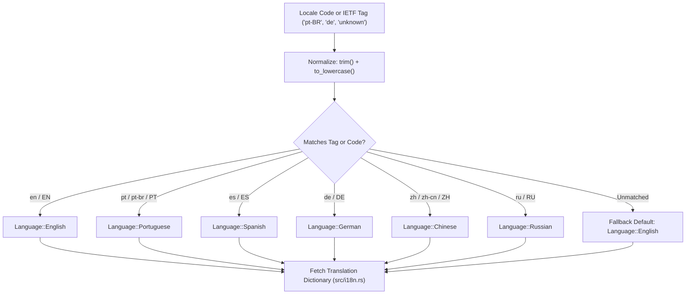
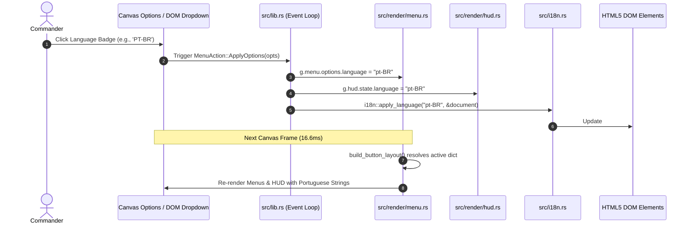

# Outpost 2: Divided Destiny — In-Game Localization (i18n) & Multilingual Presentation Architecture

## 1. Overview & Architectural Philosophy

The Outpost 2 WebAssembly engine features an authentic, strongly-typed, 6-language internationalization and localization subsystem (`src/i18n.rs`). Designed to support international colonial commanders across Earth and Tethys, this system delivers complete native multilingual coverage spanning:

- **Retro Canvas UI Menus**: Main Title Splash, Scenario Theater Selector, Mission Briefing Screen, Skirmish Setup Lobby, Options Matrix, and Tactical Pause Overlay.
- **In-Game Command HUD & Telemetry**: Resource gauges (Common Ore, Rare Ore, Food, Power, Colony Population, Sol Counter), dynamic energy grid status, food security state, morale rating tiers, factory assembly queues, and technology research browsers.
- **Tactical Campaign Briefings**: Mission titles, planetary narrative summaries, and operational directives across all 7 canonical scenarios (Eden 1–3, Plymouth 1–3, and the Cadet Training Academy).
- **Post-Mission Debriefing & Operational Evaluation**: Victory/Defeat evaluation banners, statistical analysis breakdown labels, and Colonial Merit Ranks (Supreme Colony Savior, Distinguished Pioneer, Tethys Survivor, Colony Failure).
- **DOM Telemetry & P2P WebRTC Signaling**: Dynamic live synchronization between canvas rendering context and HTML5 DOM accessibility tree.

---

## 2. Canonical Project Languages

The engine specifies and supports six canonical language profiles via the strongly typed `Language` enum:

| Variant | ISO Tag | Short Code | Native Designation | Writing System | Fallback Precedence |
| :--- | :--- | :--- | :--- | :--- | :--- |
| `Language::English` | `en` | `EN` | English | Latin (ASCII) | Canonical Master (Default) |
| `Language::Portuguese` | `pt-BR` | `PT` | Português (Brasil) | Latin (Extended) | English |
| `Language::Spanish` | `es` | `ES` | Español | Latin (Extended) | English |
| `Language::German` | `de` | `DE` | Deutsch | Latin (Extended) | English |
| `Language::Chinese` | `zh-CN` | `ZH` | 简体中文 | Simplified Hanzi | English |
| `Language::Russian` | `ru` | `RU` | Русский | Cyrillic | English |

### 2.1 Language Parsing & Fallback Resolution
Locale detection handles IETF BCP 47 tags (`pt-BR`, `zh-CN`), short codes (`en`, `de`, `ru`), and case-insensitive inputs (`ES`, `pt`). If an unmapped or invalid locale is supplied, the resolution pipeline deterministically falls back to `Language::English`, ensuring zero runtime panics or null references.



---

## 3. Strongly-Typed Dictionary Schemas

Rather than untyped JSON blobs or loose key-value string maps prone to runtime typos and missing entries, the Outpost 2 i18n architecture defines static, strongly-typed compile-time dictionary structs:

### 3.1 Dictionaries Specification

```rust
pub struct Translation {
    // Backward-compatible HUD telemetry shortcuts
    pub faction: &'static str,
    pub sol: &'static str,
    pub sun: &'static str,
    pub pop: &'static str,
    pub power: &'static str,
    pub common_ore: &'static str,
    pub rare_ore: &'static str,
    pub food: &'static str,
    pub build_base: &'static str,
    pub units: &'static str,
    pub research: &'static str,
    pub save: &'static str,
    pub load: &'static str,
    pub radar: &'static str,
    pub briefing: &'static str,
    pub music: &'static str,

    // Specialized subsystem dictionaries
    pub main_menu: MainMenuDict,
    pub skirmish: SkirmishDict,
    pub multiplayer: MultiplayerDict,
    pub briefing_scenarios: [BriefingScenarioDict; 7],
    pub hud: HudDict,
    pub debriefing: DebriefingDict,
    pub units_buildings: UnitBuildingDict,
    pub options: OptionsDict,
    pub pause_menu: PauseMenuDict,
}
```

### 3.2 Subsystem Dictionary Descriptions
1. **`MainMenuDict`**: Navigation actions (*New Campaign*, *Skirmish Battle*, *Multiplayer Lobby*, *Load Archive*, *System Options*, *Resume Operation*, *Begin Operation*), Sierra subtitle branding, and operational checklist headers.
2. **`SkirmishDict`**: Tactical setup controls (*Map Selection*, *Player Faction*, *Bot Count*, *AI Personalities* [Aggressive Rusher, Defensive Fortifier, Economic Tech Rusher], *Difficulty Levels* [Easy, Medium, Hard], *Ore Abundance* [Sparse, Standard, Abundant, Infinite], *Disaster Frequencies* [Disabled, Low, Standard, Catastrophic], and *Launch*).
3. **`MultiplayerDict`**: Serverless WebRTC signaling actions (*Host Match*, *Join as Guest*, *Copy Offer*, *Paste Answer*, *Generate Answer*, *Copy Answer*, *Ready Toggle*, *Launch Match*, and connection status banners).
4. **`BriefingScenarioDict`**: Detailed scenario lore across all 7 missions:
   - Eden 1: *A New Beginning*
   - Eden 2: *Securing the Perimeter*
   - Eden 3: *The Phoenix Project*
   - Plymouth 1: *Breaking Away*
   - Plymouth 2: *Defense of Hope*
   - Plymouth 3: *Reaching for the Stars*
   - Academy: *Cadet Training Academy*
5. **`HudDict`**: Real-time HUD alerts and telemetry:
   - Energy Grid States: *OPTIMAL*, *BROWNOUT*, *BLACKOUT*
   - Sustenance Conditions: *SURPLUS*, *ADEQUATE*, *RATIONING*, *STARVATION*
   - Morale Tiers: *EXCELLENT*, *GOOD*, *FAIR*, *POOR*, *RIOTING*
   - Factory production queues and technology research trees.
6. **`DebriefingDict`**: Mission outcome evaluations, victory/defeat titles, and colonial merit ranks:
   - Rank 1: **Supreme Colony Savior** (*Colony Savior Badge*)
   - Rank 2: **Distinguished Pioneer** (*Distinguished Service Medal*)
   - Rank 3: **Tethys Survivor** (*Survival Ribbon*)
   - Rank 4: **Colony Failure** (*Disciplinary Notice*)
7. **`UnitBuildingDict`**: Full translated nomenclature for colony infrastructure (Command Center, Common Ore Smelter, Solar Power Array, Vehicle Factory, Structure Factory, Research Lab, Domes) and combat/utility chassis (Cargo Truck, ConVec, Miner, Earthworker, Robo-Surveyor, Lynx, Panther, Tiger).
8. **`OptionsDict`**: Audio sliders (*Master Audio Volume*, *Tactical SFX & Voice*, *Dynamic Soundtrack*), simulation velocity multipliers (0.5x, 1.0x, 2.0x, 4.0x), CRT scanlines (*Enabled* / *Disabled*), and language selector badges.
9. **`PauseMenuDict`**: In-game tactical suspension overlay (*Resume*, *QuickSave*, *QuickLoad*, *Save/Load Manager*, *Options*, *Restart*, *Surrender*).

---

## 4. Live Dynamic Language Switching Pipeline

The game supports instantaneous language changes without reload or simulation state loss:



### 4.1 Zero-Latency Canvas Updating
`MenuManager::build_button_layout` executes every frame dynamically against `self.options.language`. As soon as `options.language` is updated, button labels, modal headers, briefings, and dialogs reflect the new locale instantaneously.

### 4.2 DOM Telemetry Synchronization
When `i18n::apply_language(lang_code, doc)` executes, it updates all DOM HUD labels (`lbl-faction`, `lbl-sol`, `lbl-sun`, `lbl-pop`, `lbl-power`, `lbl-ore`, `lbl-rare`, `lbl-food`, `lbl-starship`), bottom bar control buttons (`btn-build`, `btn-units`, `btn-research`, `btn-multiplayer`, `btn-save`, `btn-load`, `btn-briefing`, `btn-music`, `btn-pause`), and synchronizes the HTML `<select id="lang-select">` value.

---

## 5. Verification & Quality Assurance

The localization subsystem is enforced through exhaustive automated unit and integration tests:

1. **`test_language_enum_variants_and_codes`**: Verifies 6 variants with correct short codes, IETF tags, and native titles.
2. **`test_language_code_and_tag_parsing`**: Verifies exact and case-insensitive resolution for all supported languages.
3. **`test_language_fallback_resolution`**: Verifies unmapped inputs gracefully fallback to English.
4. **`test_dictionary_completeness_all_languages`**: Verifies all 6 language dictionaries contain 100% populated non-empty strings across every menu, HUD, debriefing, and briefing field.
5. **`test_briefing_scenario_retrieval_all_languages`**: Verifies all 7 campaign scenarios (Eden 1–3, Plymouth 1–3, Academy) return valid localized titles, narrative transcripts, and directives.
6. **`test_structure_and_vehicle_translation_integrity`**: Verifies all building and vehicle chassis display names exist and are non-empty across all 6 locales.
7. **`test_hud_and_debriefing_rank_translations`**: Verifies energy grid states, sustenance states, morale tiers, and performance rank descriptions resolve correctly.

All 112 engine unit and integration tests pass with 0 errors and 0 warnings.
