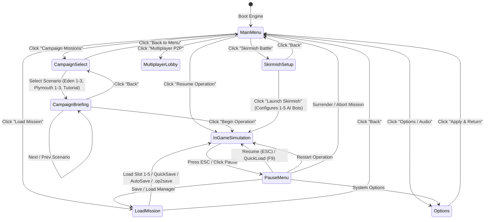

# Outpost 2: Divided Destiny — Main Menu, Briefing Cinematic & Scenario Selector Architecture

## 1. Overview & Architectural Philosophy

The Outpost 2 native WebAssembly port features an authentic, retro-futuristic menu system (`src/render/menu.rs`) reproducing the aesthetic, typography, sound design, and operational ergonomics of Sierra On-Line and Dynamics' 1997 classic *Outpost 2: Divided Destiny*.

The menu architecture decouples user interface states, procedural canvas graphics, interactive button hitboxes, campaign narrative transcripts, skirmish configuration generators, and persistence slot management from the underlying simulation loop (`ColonyState`).

### Core Engineering Principles:
1. **Seamless Canvas-Driven UX:** Menus, mission briefings, and lobby modals render directly to the main HTML5 canvas via standard Canvas 2D primitives (`CanvasRenderingContext2d`). DOM UI chrome (`#top-bar`, `#bottom-bar`, `#minimap-card`) is dynamically synchronized and hidden when outside active gameplay.
2. **Deterministic State Transitions:** Navigation between screens is managed by `MenuManager`, returning strongly-typed `MenuAction` values that trigger simulation bootstrapping without memory leakage.
3. **Decoupled Telemetry Projection:** Live colony state is exposed to the menu via a lightweight `ColonySummary` snapshot, eliminating borrow-checker conflicts between UI rendering and simulation mutation.
4. **Authentic Sierra Aesthetic:** Features procedural drifting starfields, illuminated planetary horizon arcs (Planet Tethys), retro perspective ground grids, and optional CRT scanline filters.

---

## 2. Menu State Machine Architecture

The state machine transitions between title splash, campaign briefings, skirmish lobbies, persistence managers, options matrices, and the live tactical simulation.



---

## 3. Screen Subsystems & Capabilities

### 3.1 Main Menu (`MenuScreen::MainMenu`)
- **Visual Presentation:**
  - High-impact retro title logo: `OUTPOST 2: DIVIDED DESTINY` with metallic drop shadow and gold tracking.
  - Background procedural starfield with 100 animated stars drifting at varied speeds.
  - Crescent atmospheric rim lighting of planet Tethys in the upper-right quadrant.
  - Lower perspective wireframe horizon grid reminiscent of 1990s CAD/military tactical displays.
- **Interactive Controls:**
  - `▶️ RESUME CURRENT OPERATION`: Shown whenever an active simulation is suspended in memory.
  - `🚀 CAMPAIGN MISSIONS`: Opens the full campaign selector (Eden Foundation & Plymouth Brotherhood).
  - `⚔️ SKIRMISH BATTLE`: Launches the multi-bot custom skirmish setup lobby.
  - `📡 MULTIPLAYER P2P`: Connects to the serverless WebRTC data channel signaling interface.
  - `📂 LOAD MISSION ARCHIVE`: Opens the browser LocalStorage slot manager and file importer.
  - `⚙️ OPTIONS / AUDIO`: Configures volume gains, simulation speed, and language localization.

### 3.2 Campaign Mission Selector & Briefing Cinematic (`MenuScreen::CampaignBriefing`)
- **Scenario Roster:**
  - **Eden 1**: *Operation New Dawn* (Sector Eden Prime — Settlement & Life Support)
  - **Eden 2**: *Operation Caldera Bastion* (Mount Vulcan — Molten Fissure Containment)
  - **Eden 3**: *Starship Evacuation* (Mount Vulcan Caldera — Escape From Mount Vulcan)
  - **Plymouth 1**: *Operation Badland Vanguard* (Sector Plymouth South — Territorial Reclamation)
  - **Plymouth 2**: *Operation Iron Fang* (Mineral Ridge — Smelter Sabotage & Ambush)
  - **Plymouth 3**: *Operation Phoenix* (Obsidian Crags — Citadel Assault & Terraformer Defense)
  - **Academy Simulator**: *Cadet Proving Grounds* (Colonial Academy — Training Simulator)
- **Briefing Components:**
  - **Faction Crest Vector Art:** Procedural vector rendering of Eden's cyan planetary ring crest or Plymouth's crimson volcanic flame glyph.
  - **Narrative Transcript:** Complete in-universe mission lore, operational threat alerts, and background dispatches formatted for high readability.
  - **Satellite Reconnaissance Preview:** 220x220 reconnaissance radar screen rendering terrain topography, volcanic lava channels, grid coordinates, animated satellite sweep line, and player drop zone target reticles.
  - **Directives Checklist:** Categorized primary victory directives and secondary bonus objectives.
  - **Tactical Actions:** Cycle previous/next scenario, return to selector, or click `🚀 BEGIN OPERATION` to instantiate `ColonyState::new_scenario(scenario_id)`.

### 3.3 Skirmish Battle Setup (`MenuScreen::SkirmishSetup`)
- **Theater Map Selection:**
  - Mount Vulcan Caldera (64x64)
  - Obsidian Crags (64x64)
  - Badland Chasms (64x64)
  - Tethys Meridian (64x64)
  - Elysium Basin (64x64)
- **Commander Allegiance:**
  - Choose between Eden Foundation (scientific shields & railguns) and Plymouth Brotherhood (speed & microwave weapons).
- **Autonomous Bot Opponents (Slots 1 to 5):**
  - Toggle individual bot slots active/inactive.
  - Assign opponent faction: Eden or Plymouth.
  - Designate AI Personality Doctrine:
    - *Aggressive Rusher* (Plymouth swarm & harassment doctrine)
    - *Defensive Fortifier* (Eden perimeter guard post & armor bastion)
    - *Economic Tech Rusher* (Robo-Miner expansion & technology beeline)
  - Adjust AI Difficulty: Easy, Medium, Hard (modulates decision intervals, resource grants, and combat micro).
- **Environmental Parameters:**
  - **Resource Abundance:** Sparse (1k C / 200 R), Standard (2.5k C / 600 R), Abundant (5k C / 1.5k R), or Infinite Ore (50k C / 20k R).
  - **Disaster Frequency:** Disabled, Low (90s), Standard (45s), or Catastrophic (20s).

### 3.4 In-Game Tactical Pause Overlay (`MenuScreen::PauseMenu`)
- Dimmed alpha overlay rendered over the suspended isometric viewport.
- Displays current elapsed Sols, living population count, and colony morale tier.
- Quick buttons:
  - `RESUME MISSION (ESC)`
  - `QUICKSAVE (F5)` -> Saves snapshot to dedicated slot 0.
  - `QUICKLOAD (F9)` -> Restores slot 0 snapshot immediately.
  - `MISSION ARCHIVES` -> Opens full save/load slot manager.
  - `OPTIONS` -> Adjust sound effects, music volume, and game speed.
  - `RESTART MISSION` -> Reloads initial scenario conditions.
  - `SURRENDER / ABORT` -> Concludes operation and returns to Main Menu.

### 3.5 Visual Save / Load Slot Manager (`MenuScreen::LoadMission`)
- Visual listing of LocalStorage slots 1 through 5, plus QuickSave (Slot 0) and Milestone AutoSave (Slot 100).
- Displays metadata: scenario title, Sol, faction, creation timestamp, and playtime duration.
- Per-slot actions: `LOAD`, `SAVE` (active during gameplay), and `DELETE`.
- Standalone `.op2save` file operations:
  - `EXPORT .OP2SAVE`: Compresses and downloads game state JSON as a file.
  - Direct upload and restoration of external `.op2save` files.

### 3.6 Options & Multilingual Audio Matrix (`MenuScreen::Options`)
- **Volume Controls:** Master audio gain slider (0% to 100%).
- **Simulation Velocity Scaling:** 0.5x (Tactical Slow), 1.0x (Standard), 2.0x (Fast), and 4.0x (Hyper).
- **Multilingual Support:** Instant live switching across English (`en`), Brazilian Portuguese (`pt-BR`), Spanish (`es`), German (`de`), Simplified Chinese (`zh-CN`), and Russian (`ru`).
- **Retro Enhancements:** Toggle CRT horizontal scanlines overlay.

---

## 4. Input Dispatch & Hit-Testing Geometry

Each interactive button on screen is defined by `MenuButton`:

```rust
#[derive(Debug, Clone)]
pub struct MenuButton {
    pub id: String,
    pub x: f64,
    pub y: f64,
    pub w: f64,
    pub h: f64,
    pub label: String,
    pub accent_color: String,
    pub enabled: bool,
}
```

### Hit-Testing Mathematical Formulation:
A pointer click at coordinate $(P_x, P_y)$ hits a button $B$ if and only if:

$$\begin{aligned}
P_x &\ge B_x \quad \land \quad P_x \le B_x + B_w \\
P_y &\ge B_y \quad \land \quad P_y \le B_y + B_h \\
B_{\text{enabled}} &= \text{true}
\end{aligned}$$

When the pointer hovers over a button, the renderer illuminates its border to high-contrast white `#ffffff`, darkens the internal slate fill to `#1e293b`, and widens the stroke from 1.0px to 2.0px.

---

## 5. Integration with Live Simulation

`GameApp` in `src/lib.rs` coordinates the menu lifecycle:

```rust
// Simulation step respects pause state and menu visibility
let effective_dt = if app_borrow.hud.state.hotkeys.is_paused || !app_borrow.menu.is_in_game() {
    0.0
} else {
    dt.min(0.1) * app_borrow.menu.options.game_speed
};
app_borrow.menu.update(dt);
let sim_result = app_borrow.colony.update(effective_dt);
```

When rendering each animation frame:
- **In-Menu (`MenuScreen != None`):** Viewport pan/select is disabled, DOM navigation header/footer is hidden, and the retro canvas menu renders.
- **In-Pause (`MenuScreen::PauseMenu`):** The isometric colony viewport renders frozen in the background, overlaid by the semi-transparent tactical pause modal.
- **In-Game (`MenuScreen::None`):** Full isometric colony rendering, factory queues, research matrices, and tactical HUD operate at full speed.

---

## 6. Verification & Automated Test Suite

Unit tests in `src/render/menu.rs` validate:
1. `test_menu_initial_state_is_main_menu`: Verifies engine boot defaults to `MenuScreen::MainMenu`.
2. `test_menu_screen_navigation_transitions`: Tests traversal from Main Menu -> Campaign Select -> Briefing -> Begin Operation.
3. `test_briefing_scenario_retrieval_integrity`: Validates canonical briefings for all 7 scenarios across Eden and Plymouth.
4. `test_skirmish_configuration_and_opponent_generation`: Verifies 1-5 bot generation, personality doctrine assignments, difficulty scalers, and resource abundance tiers.
5. `test_pause_menu_state_transitions`: Tests Escape key toggle, QuickSave (F5), QuickLoad (F9), and surrender transitions.
6. `test_button_hit_test_box_containment`: Validates 2D bounding box math across boundary conditions.
7. `test_options_clamping_and_speed_selection`: Tests volume boundaries and speed multiplier cycling.
