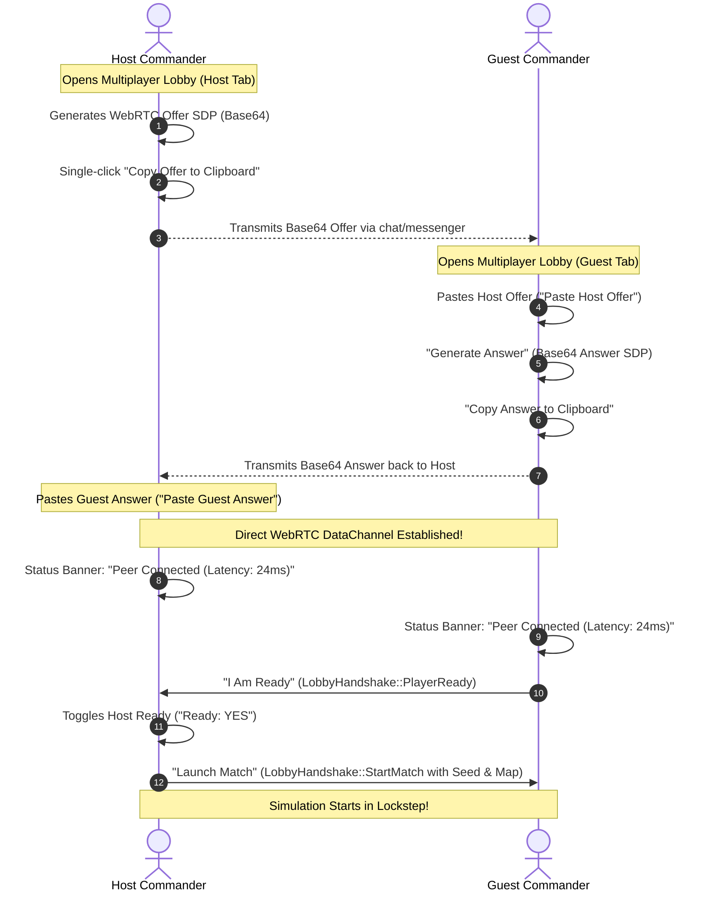

# Outpost 2: Divided Destiny — Multiplayer Matchmaking, HUD Telemetry & Tactical Chat

## 1. Overview & Architectural Philosophy

*Outpost 2: Divided Destiny* multiplayer delivers a deterministic, peer-to-peer real-time tactical experience between opposing colony commanders (Eden vs. Plymouth). Operating over WebRTC DataChannels with zero centralized matchmaking servers, the multiplayer subsystem connects room setup, signaling, in-game network telemetry, peer status indicators, and tactical communications.

### Core Tenets:
1. **Zero-Server Manual Signaling:** Players exchange compact Base64-encoded Session Description Protocol (SDP) payloads directly via the clipboard or URL query parameters, eliminating server dependencies.
2. **Deterministic Lockstep Synchronization:** Both clients execute symmetric simulations governed by synchronized seeds, tracking lockstep turns and detecting desynchronization.
3. **Live Telemetry & Diagnostics:** Continuous roundtrip ping (RTT), peer status pills, and turn-buffered lockstep status badges are rendered directly in the in-game HUD command bar.
4. **Color-Coded Tactical Communications:** In-game tactical chat provides instant, faction-branded messages (`[Eden]` cyan, `[Plymouth]` coral/red) with responsive keyboard activation via `Enter`.

---

## 2. Multiplayer Match Setup & Lobby UI Integration

The match lobby state machine is integrated directly into the Canvas rendering pipeline (`MenuScreen::MultiplayerLobby` in `src/render/menu.rs`) backed by `LobbyRoom` (`src/net/lobby.rs`).



### 2.1 Host Tab Specifications
- **Base64 SDP Offer Display:** Monospace preview box displaying the self-contained WebRTC offer containing bundled ICE candidates.
- **Copy Offer to Clipboard:** Single-click button (`btn_copy_offer`) copying the offer payload to the system clipboard via Web API `navigator.clipboard.write_text`.
- **Guest Answer Input:** Interactive field and paste action button (`btn_paste_answer`) ingesting the guest's response SDP.
- **Planetary Theater Selector:** Map cycler (`btn_mp_map_prev`, `btn_mp_map_cycle`, `btn_mp_map_next`) supporting:
  - `Eden 1: The New Frontier`
  - `Eden 2: Discovery at Mount Plymouth`
  - `Eden 3: The Gathering Storm`
  - `Plymouth 1: Seeds of Dissent`
  - `Plymouth 2: Red Planet Crucible`
  - `Plymouth 3: Final Exodus`
  - `Procedural Skirmish`
- **Connection Status Banner:** Dynamic status indicator transitioning from:
  - `Awaiting Guest Connection...` (Amber `#facc15`)
  - `Peer Connected (Latency: 24ms)` (Green `#4ade80`)
- **Commander Readiness & Launch Match:**
  - Host readiness toggle (`btn_mp_toggle_host_ready`).
  - "Launch Match" button (`btn_launch_match`), enabled and highlighted in `#4ade80` only when both commanders are linked and ready (`is_ready_to_launch() == true`).

### 2.2 Guest Tab Specifications
- **Host Offer Input:** Paste container (`btn_paste_offer`) accepting the Host's Base64 SDP payload.
- **Generate Answer:** Action button (`btn_generate_answer`) invoking `WebRtcSession::accept_offer_and_create_answer`.
- **Copy Answer to Clipboard:** Single-click action button (`btn_copy_answer`) storing the answer SDP to the clipboard.
- **Readiness Toggle:** Clear "I Am Ready" button (`btn_toggle_ready`) updating local and networked readiness state.

---

## 3. In-Game Network Telemetry Widget

Located in the tactical top bar (`render_command_bar` and `render_network_telemetry_widget` in `src/render/hud.rs`), the live telemetry widget provides real-time connection vitals during gameplay:

| Component | Format / Label | Visual Styling | Description |
|---|---|---|---|
| **Peer Status Badge** | `P2P ACTIVE: Host & Guest` | Green pill badge (`#4ade80`, bg: `rgba(34,197,94,0.2)`) | Indicates active, bidirectional WebRTC DataChannel connection. Displays `P2P STANDBY` when disconnected. |
| **Ping Telemetry Meter** | `Ping: 18ms` | Cyan (`< 50ms`), Amber (`< 150ms`), Red (`>= 150ms`) | Real-time roundtrip latency measured across heartbeats and ping timestamps. |
| **Lockstep Sync Status** | `In Sync: Turn 1240` | Cyan `#38bdf8` / Orange `#fb923c` | Turn-buffered lockstep simulation index. Displays `Buffering: Turn 1240` during packet reordering or catch-up. |

---

## 4. Tactical Multiplayer Chat System

The tactical chat subsystem (`TacticalChatState` in `src/render/hud.rs` & `src/lib.rs`) enables seamless in-game commander communication:

### 4.1 Chat Lifecycle & Controls
1. **Focus / Open Prompt:** Pressing `Enter` while in-game immediately focuses the tactical chat input bar at the bottom-left of the canvas.
2. **Text Buffering & Cursor:** User keystrokes are buffered directly into `chat.input_buffer` with a retro monospace blinking cursor (`_`). Standard game hotkeys (e.g., `P` for pause, `1-9` for unit control groups) are temporarily suppressed while typing.
3. **Dispatch Message:** Pressing `Enter` commits the message, resets the buffer, closes the prompt, and dispatches the payload via `WebRtcSession::send_chat`:
   ```rust
   let msg = NetMessage::ChatMessage {
       sender: sender_name.to_string(),
       text: text.to_string(),
   };
   session.send_message(&msg);
   ```
4. **Cancel / Close:** Pressing `Escape` or submitting an empty string closes the prompt without sending.

### 4.2 Color-Coded Faction Displays
Messages rendered in the tactical HUD log (`render_alerts_and_chat`) display faction-specific brand styling:
- **Eden Faction:** Cyan prefix `[Eden] Player1:` (`#38bdf8`)
- **Plymouth Faction:** Coral prefix `[Plymouth] Sarah:` (`#f87171`)
- **System / Radio Alerts:** Amber/Yellow prefix `[Radio]:` (`#facc15`)
- **Message Body:** Clean slate white text (`#f1f5f9`)

Example rendered lines:
```text
[Eden] Player1: Need assistance at south ridge!
[Plymouth] Sarah: Affirmative! Dispatching Lynxes to south ridge.
```

### 4.3 Queue Management
The in-memory message buffer (`TacticalChatState::messages`) maintains a FIFO eviction policy capped at `max_messages` (default 50 entries), preventing unbounded memory growth during prolonged skirmishes.

---

## 5. Verification & Unit Test Suite

The multiplayer matchmaking, telemetry, and chat subsystems are validated across the test suite (`cargo test`):

1. **Lobby Copy Workflow (`net::lobby::tests::test_multiplayer_lobby_offer_answer_copy_workflow`):**
   - Validates Host offer SDP generation and clipboard extraction.
   - Validates Guest offer pasting and answer generation.
   - Validates Guest answer pasting on Host and connection state transition.
   - Validates status banner formatting (`Awaiting Guest Connection...` -> `Peer Connected (Latency: 24ms)`).
   - Validates readiness gating before `launch_match`.
2. **Map Selector & Cycling (`net::lobby::tests::test_map_selector_and_cycle`):**
   - Validates cyclic iteration across Eden 1-3, Plymouth 1-3, and Procedural Skirmish.
3. **Network Telemetry Formatting (`render::hud::tests::test_network_telemetry_formatting`):**
   - Tests peer status badges (`P2P ACTIVE: Host & Guest` vs `P2P STANDBY`).
   - Tests ping telemetry formatting (`Ping: 18ms`, `Ping: 24ms`, `Ping: 32ms`).
   - Tests lockstep synchronization formatting (`In Sync: Turn 1240` vs `Buffering: Turn 1240`).
4. **Tactical Chat Dispatch & Eviction (`render::hud::tests::test_tactical_chat_message_dispatch_and_queue_management`):**
   - Tests text typing buffer, backspace, and commit lifecycle.
   - Tests faction color coding and prefix formatting (`[Eden] Player1:`, `[Plymouth] Sarah:`).
   - Tests FIFO message queue eviction at capacity.
5. **Menu UI Integration (`render::menu::tests::test_multiplayer_lobby_tab_switching_and_buttons`):**
   - Tests Host and Guest tab layout generation, button hitboxes, map cycler, readiness toggles, and match launch action dispatch.
