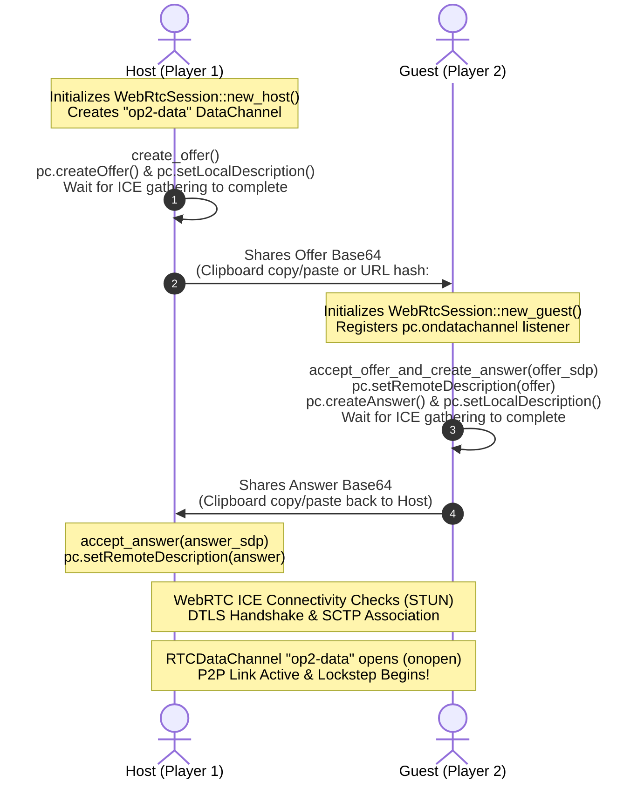

# Outpost 2: Divided Destiny — WebRTC Peer-to-Peer Multiplayer Protocol Specification

## 1. Overview & Architectural Philosophy

*Outpost 2: Divided Destiny* requires real-time tactical synchronization between rival colony commanders (Eden vs. Plymouth). In this modern Rust/WASM port, multiplayer networking operates over a **serverless, peer-to-peer WebRTC architecture** utilizing `RTCDataChannel`.

### Core Tenets:
1. **Zero Central Infrastructure:** No matchmaking, lobby, or relay servers are required. Direct browser-to-browser links are negotiated via standard public STUN servers (`stun.l.google.com:19302`) and manual signaling.
2. **Deterministic Lockstep Simulation:** All game logic executes symmetrically on each player's client. Only player intentions (unit orders, production queues, chat) and sync heartbeats are transmitted across the wire.
3. **Ordered & Reliable SCTP Delivery:** Game packets travel over an ordered WebRTC DataChannel backed by Stream Control Transmission Protocol (SCTP) over DTLS/UDP, guaranteeing packet sequence integrity without head-of-line TCP blocking.

---

## 2. Zero-Server Signaling Architecture

Establishing a direct WebRTC peer connection typically requires exchanging Session Description Protocol (SDP) offers and answers. In standard web applications, a central WebSocket or HTTP server coordinates this signaling. Outpost 2 bypasses centralized servers entirely by encapsulating the fully gathered SDP and ICE candidate list into a single, compact, Base64-encoded string.

### Signaling Workflow



### Self-Contained Candidate Bundling
In standard trickle-ICE WebRTC, ICE candidates are sent incrementally. For copy-paste signaling, `WebRtcSession` waits for `pc.ice_gathering_state()` to reach `Complete` (or until candidate is `null`, with a 1500 ms safety timeout). Consequently, all host, server reflexive (STUN), and peer-reflexive candidates are embedded directly within the initial SDP payload.

### Signaling Payload Format (`SignalingMessage`)
```json
{
  "type": "offer",
  "sdp": "v=0\r\no=- 123456789 2 IN IP4 127.0.0.1\r\ns=-\r\nt=0 0\r\na=group:BUNDLE 0\r\n..."
}
```
The JSON object is Base64-encoded using standard alphabet (`base64::engine::general_purpose::STANDARD`). The system supports both Base64 strings and raw JSON input, providing resilient fallback if a player pastes raw text.

---

## 3. DataChannel Wire Protocol (`NetMessage`)

All network communication across the `"op2-data"` data channel utilizes a deterministic, typed packet protocol implemented in `src/net/protocol.rs`.

Packets are serialized as internally tagged JSON strings (`{"type": "..."}`) or binary slices.

### Packet Types Specification

| Packet Variant | Fields | Purpose |
|:---|:---|:---|
| `Handshake` | `player_name: String`<br/>`faction: Faction`<br/>`scenario_id: usize` | Synchronizes commander names, faction selection (`Eden` or `Plymouth`), and mission scenario index prior to simulation launch. |
| `UnitOrder` | `unit_ids: Vec<u32>`<br/>`order: NetOrder` | Dispatches tactical commands to one or multiple selected combat/logistics units. |
| `QueueProduction` | `building_id: u32`<br/>`item: String` | Queues vehicle or structure kit fabrication at a Vehicle Factory or Structure Factory. |
| `RecycleStructure` | `building_id: u32` | Commands a building to bulldoze/recycle itself to reclaim metals and power grid capacity. |
| `ChatMessage` | `sender: String`<br/>`text: String` | Inter-colony communications displayed in the tactical chat HUD. |
| `SyncHeartbeat` | `tick: u64`<br/>`sol: f64` | Lockstep verification heartbeat sent each turn to detect Out-of-Sync (OOS) state divergences. |

---

## 4. Tactical Order Specification (`NetOrder`)

Units in *Outpost 2* accept structured tactical commands mapped to `NetOrder`:

```rust
#[derive(Debug, Clone, PartialEq, Eq, Serialize, Deserialize)]
pub enum NetOrder {
    MoveTo(i32, i32),
    Attack(u32),
    Patrol(i32, i32, i32, i32),
    Guard(i32, i32),
    Repair(u32),
    Bulldoze(i32, i32),
    DeployConVec(i32, i32),
}
```

### Order Semantics:
1. **`MoveTo(x, y)`**: Orders units to navigate using A* pathfinding on the isometric terrain grid to destination tile `(x, y)`.
2. **`Attack(target_id)`**: Locks primary weapons onto enemy unit ID `target_id`. Units rotate chassis and turrets into range and engage autonomously.
3. **`Patrol(x1, y1, x2, y2)`**: Establishes continuous bidirectional movement between coordinates, engaging hostile incursions encountered along the route.
4. **`Guard(x, y)`**: Anchors units to a defensive post at `(x, y)`. Units intercept intruders within 6 tiles and return to the anchor point upon threat neutralization.
5. **`Repair(target_id)`**: Directs Repair Vehicles to target friendly vehicles or buildings, projecting nano-repair beams to restore HP.
6. **`Bulldoze(x, y)`**: Orders Robo-Dozer or Earthworker units to clear volcanic debris, microbial blight, or level terrain.
7. **`DeployConVec(x, y)`**: Deploys cargo structure kit loaded on a ConVec at tile `(x, y)` to erect colonies.

---

## 5. Wire Examples

### 1. Initial Handshake
```json
{
  "type": "Handshake",
  "player_name": "Commander Roark",
  "faction": "Eden",
  "scenario_id": 1
}
```

### 2. Multi-Unit Tactical Attack Order
```json
{
  "type": "UnitOrder",
  "unit_ids": [101, 102, 105],
  "order": {
    "Attack": 204
  }
}
```

### 3. Factory Production Queue
```json
{
  "type": "QueueProduction",
  "building_id": 42,
  "item": "Lynx Railgun Tank"
}
```

### 4. Lockstep Sync Heartbeat
```json
{
  "type": "SyncHeartbeat",
  "tick": 7200,
  "sol": 15.0
}
```

---

## 6. Lockstep Order Synchronization Model

To maintain perfect simulation synchrony between browser instances without sending entire game states across the network, Outpost 2 uses a **Turn-Buffered Lockstep Pipeline**:

```
[Local Input Captured] ---> [Assigned to Tick T + 2] ---> [Transmitted over WebRTC]
                                                                  |
[Tick T Simulation Execution] <--- [All Orders for Tick T Verified] <---'
```

### Execution Rules:
1. **Fixed Simulation Rate:** The simulation loop advances at a fixed 20 Hz tick rate (50 ms per simulation turn).
2. **Turn Buffering (Latency Hiding):** Orders issued by a player during tick $T$ are stamped for execution at tick $T + \Delta$ (typically $\Delta = 2$ turns / 100 ms). This allows network transmission across the WebRTC link without stuttering.
3. **Lockstep Barrier:** Neither client advances the world state from tick $T$ to $T + 1$ until all orders (or null/heartbeat messages) for tick $T$ from both peers have been received.
4. **Deterministic PRNG & Physics:** Terrain disaster generation, weapon spread, and combat damage calculations use seeded pseudo-random number generators synchronized during the `Handshake`.
5. **Desync Detection:** Every 100 ticks (5 seconds), both peers exchange `SyncHeartbeat { tick, sol }`. If the simulation sol or checksum fails to match, an Out-of-Sync (OOS) alert is displayed and the match pauses for resynchronization.

---

## 7. Public Rust API (`src/net/`)

The subsystem provides clean, idiomatic Rust APIs:

```rust
use outpost2::net::{WebRtcSession, NetMessage, NetOrder, Faction};

// --- Host Flow ---
let host_session = WebRtcSession::new_host()?;
let offer_base64 = host_session.create_offer().await?;
// (User shares offer_base64 with guest)

// When guest returns answer_base64:
host_session.accept_answer(&guest_answer_base64).await?;

// --- Guest Flow ---
let guest_session = WebRtcSession::new_guest()?;
let answer_base64 = guest_session.accept_offer_and_create_answer(&host_offer_base64).await?;
// (User shares answer_base64 with host)

// --- Game Loop Integration ---
if session.is_connected() {
    // Transmit local orders:
    session.send_message(&NetMessage::UnitOrder {
        unit_ids: vec![12],
        order: NetOrder::MoveTo(45, 62),
    })?;

    // Drain inbound orders from peer:
    for message in session.poll_messages() {
        match message {
            NetMessage::UnitOrder { unit_ids, order } => {
                // Apply remote player order
            }
            NetMessage::ChatMessage { sender, text } => {
                // Render chat HUD notification
            }
            NetMessage::SyncHeartbeat { tick, sol } => {
                // Verify lockstep consistency
            }
            _ => {}
        }
    }
}
```

---

## 8. Summary

The Outpost 2 WebRTC subsystem establishes instant, serverless, low-latency multiplayer gaming directly in modern web browsers. By leveraging deterministic lockstep simulation and SCTP data channels, players can enjoy authentic Divided Destiny tactical warfare with zero cloud server expenses or backend infrastructure dependencies.
