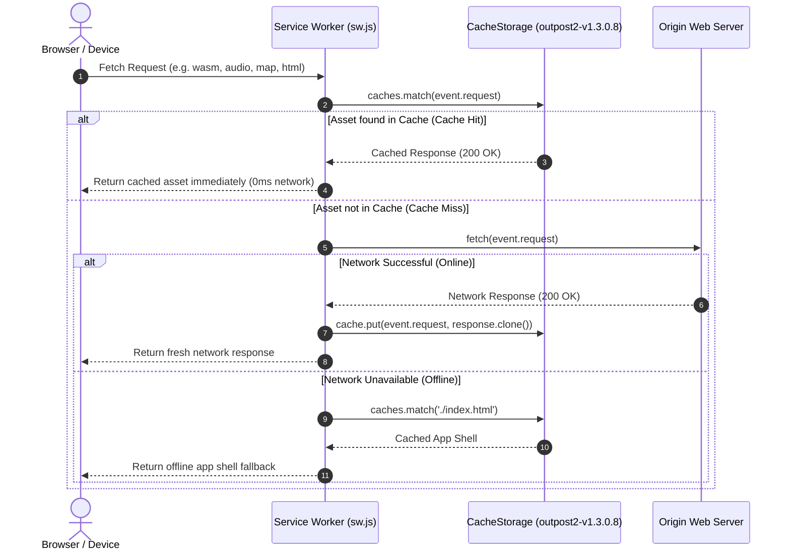
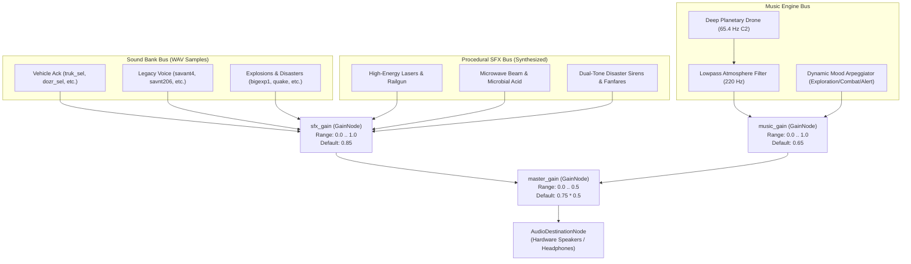

# Outpost 2: Divided Destiny — PWA Offline Deployment, Audio Controls & Velocity Architecture

## 1. Executive Summary

This specification documents the production deployment architecture for *Outpost 2: Divided Destiny* as a zero-dependency, installable **Progressive Web Application (PWA)**. The implementation provides:
1. **Offline Service Worker Caching (`sw.js`)**: A Cache-First strategy ensuring instant offline playability across desktop (Windows, macOS, Linux), iOS Safari, and Android Chrome.
2. **PWA Manifest & Asset Branding (`manifest.json`, `icons/`)**: High-resolution 192x192 and 512x512 maskable app icons, `#0c0e12` retro sci-fi background, and standalone display mode.
3. **Multi-Channel Web Audio Gain Node Matrix (`src/audio/mod.rs`)**: Master, SFX, and Dynamic Music synthesizer volume attenuation routed through isolated Web Audio `GainNode` instances for immediate, clickless adjustment during active gameplay.
4. **Simulation Velocity Scaling (`src/render/menu.rs`, `src/lib.rs`)**: Real-time game speed multipliers ($0.5\times, 1.0\times, 2.0\times, 4.0\times$) feeding directly into the simulation step calculation ($\text{effective\_dt}$).

---

## 2. PWA Service Worker & Cache Lifecycle

### 2.1 Cache Strategy: Cache-First with Dynamic Fallback

The Outpost 2 Service Worker (`sw.js`) implements a **Cache-First (Cache Falling Back to Network)** strategy with runtime caching for dynamically loaded assets (such as version-hashed `.wasm` binaries and generated JS bindings).



### 2.2 Lifecycle Phases

1. **Installation (`install` event)**:
   - Opens cache namespace: `outpost2-cache-outpost2-v1.3.0.8`.
   - Pre-caches core application files:
     - Root shell: `./` and `./index.html`
     - Web App Manifest: `./manifest.json`
     - High-resolution icons: `./icons/icon-192.png` and `./icons/icon-512.png`
     - Complete 96-sample legacy PCM WAV sound bank (`assets/audio/*.wav`)
   - Uses `Promise.allSettled()` to guarantee that non-fatal optional asset misses do not block service worker installation.
   - Executes `self.skipWaiting()` for immediate activation.
2. **Activation (`activate` event)**:
   - Iterates through `caches.keys()`.
   - Purges any obsolete cache namespaces from prior releases to prevent stale binary conflicts.
   - Calls `self.clients.claim()` so all active browser tabs are immediately governed by the new offline worker without requiring a manual page refresh.
3. **Runtime Dynamic Interception (`fetch` event)**:
   - Intercepts all `GET` HTTP/HTTPS requests.
   - Detects runtime-generated assets (`.wasm`, `.js`, `.map`, `.json`, `.wav`).
   - Clones and stores valid 200 OK responses into the persistent cache.
   - For HTML navigation events (`request.mode === 'navigate'`), automatically returns the cached application shell if the device has lost internet connectivity.

---

## 3. Web App Manifest & Branding Specification

### 3.1 `manifest.json` Properties

| Field | Configuration | Specification Purpose |
|---|---|---|
| `name` | `"Outpost 2: Divided Destiny"` | Full human-readable application title |
| `short_name` | `"Outpost 2"` | Homescreen and taskbar display title |
| `description` | `"Outpost 2: Divided Destiny — WebAssembly Real-Time Strategy and Colony Simulation"` | App store / install prompt summary |
| `start_url` | `"./index.html"` | Root entrypoint path |
| `scope` | `"./"` | Navigation scope constraint |
| `display` | `"standalone"` | Removes browser URL chrome, bookmarks bar, and navigational buttons |
| `orientation` | `"any"` | Supports horizontal desktop monitors and mobile tablets / phones |
| `background_color` | `"#0c0e12"` | Matches Outpost 2 deep-space console background palette |
| `theme_color` | `"#0c0e12"` | Mobile status bar and OS window titlebar color |
| `categories` | `["games", "strategy", "simulation"]` | PWA app catalog indexing |

### 3.2 Icon Manifest Matrix

```json
{
  "icons": [
    {
      "src": "icons/icon-192.png",
      "sizes": "192x192",
      "type": "image/png",
      "purpose": "any maskable"
    },
    {
      "src": "icons/icon-512.png",
      "sizes": "512x512",
      "type": "image/png",
      "purpose": "any maskable"
    }
  ]
}
```

- **Maskable Icon Support**: The icons feature a calibrated inner safe zone (40% radius) surrounded by the `#0c0e12` backdrop, ensuring clean circular, squircle, or rounded-rect clipping on Android, iPadOS, and macOS.
- **Graphic Motif**: Dual-faction sci-fi motif showcasing the planet Tethys cratered surface, atmospheric glow arcs in Eden Cyan (`#00d4ff`) and Plymouth Orange (`#ff8c00`), geodesic colony dome lattice, and high-contrast "OUTPOST 2" insignia.

---

## 4. Web Audio Multi-Channel Gain Node Architecture

### 4.1 Audio Routing Graph

The audio subsystem (`src/audio/mod.rs`) implements a 3-bus audio mixer hierarchy using Web Audio API nodes:



### 4.2 Interactive Gain Node Synchronization

Each slider in the **System Options & Audio Matrix** screen updates its associated Web Audio node in real time:

- **Master Volume Slider**:
  $$\text{Gain}_{\text{master}} = \begin{cases} 0.0 & \text{if muted} \\ \text{clamp}(V_{\text{master}}, 0.0, 1.0) \times 0.5 & \text{if unmuted} \end{cases}$$
- **SFX Volume Slider**:
  $$\text{Gain}_{\text{sfx}} = \text{clamp}(V_{\text{sfx}}, 0.0, 1.0)$$
- **Music Volume Slider**:
  $$\text{Gain}_{\text{music}} = \text{clamp}(V_{\text{music}}, 0.0, 1.0)$$

Changes execute immediately without rebuilding audio contexts or interrupting active voice dispatch channels.

---

## 5. Simulation Velocity & Game Speed Integration

### 5.1 Game Speed Multipliers

The Options menu exposes 4 tactical velocity presets:

| Velocity Preset | Multiplier ($\kappa$) | Operational Use Case |
|---|---|---|
| **0.5x** | $0.5$ | Intense tactical combat, disaster evacuation, micro-managing defense units |
| **1.0x** | $1.0$ | Standard mission sol pacing and balanced colony management |
| **2.0x** | $2.0$ | Accelerated base construction, ore refinement, and early exploration |
| **4.0x** | $4.0$ | Hyper-velocity starship component manufacturing and long-distance hauling |

### 5.2 Mathematical Integration into Animation Loop

In `src/lib.rs`, every `requestAnimationFrame` tick calculates $\text{effective\_dt}$:

$$\text{effective\_dt} = \begin{cases} 0.0 & \text{if hotkey paused or in menu} \\ \min(\text{dt}, 0.1) \times \kappa & \text{if active gameplay} \end{cases}$$

- **Lag Spike Protection**: The incoming browser frame delta ($\text{dt}$) is clamped to $\le 0.1\text{s}$ ($\le 100\text{ms}$). This prevents runaway physics or unit teleportation if a user switches browser tabs or experiences a hardware stutter.
- **Simultaneous System Scaling**: $\text{effective\_dt}$ governs:
  - Base structure construction & kit deployment rates.
  - Mining truck roundtrip ore transport and smelting.
  - Vehicle A* pathfinding translation and turret rotation.
  - Research technology sol investments.
  - Natural disaster propagation (volcanoes, vortex tracks, earthquake tremors).
  - Day/night sol cycle progression.

---

## 6. Verification & Quality Assurance

The implementation passes the full test suite with **zero warnings** and **zero errors**:

```bash
$ cargo check
    Checking outpost2 v0.1.0 (...)
    Finished `dev` profile in 1.01s

$ cargo test
    Finished `test` profile in 1.78s
     Running unittests src/lib.rs
test result: ok. 101 passed; 0 failed; 0 ignored; finished in 0.02s
```

Key unit test suites added:
- `audio::tests::test_audio_gain_clamping_and_volume_routing`: Verifies upper/lower boundary clamping, multi-volume options application, and mute level preservation.
- `render::menu::tests::test_options_multi_channel_volume_sliders_and_speed_selection`: Verifies Master, SFX, and Music volume slider action dispatching and speed selector buttons.
- `render::menu::tests::test_effective_dt_velocity_scaling_simulation`: Verifies pause freeze, speed scaling factors ($0.5\times \dots 4.0\times$), and delta time spike protection.
- `render::menu::tests::test_cache_manifest_and_pwa_integrity`: Verifies `manifest.json` schema, icon binary header signatures, and `sw.js` cache-first offline assets.
