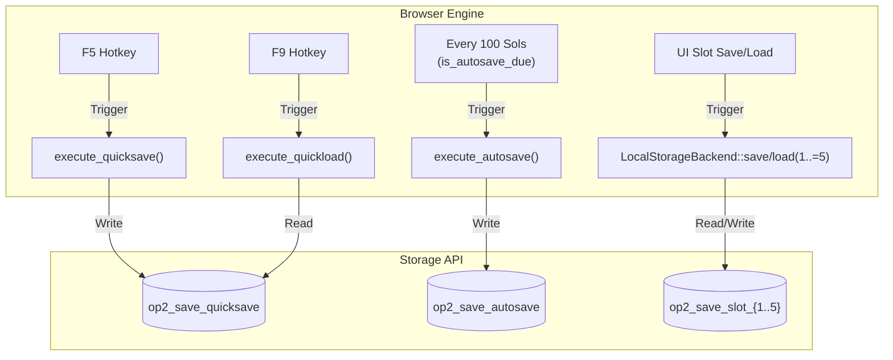
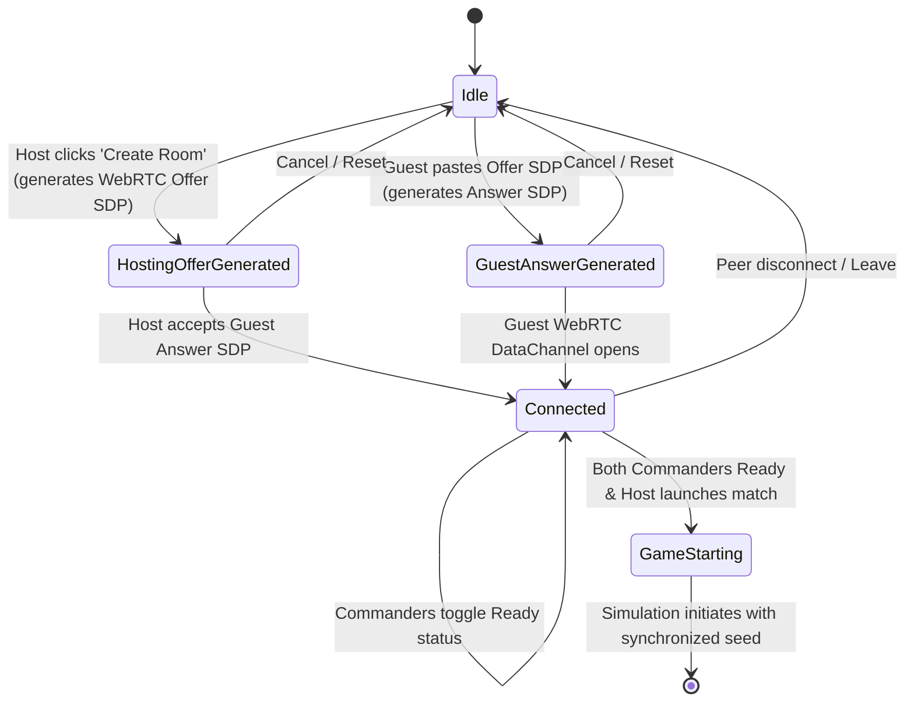
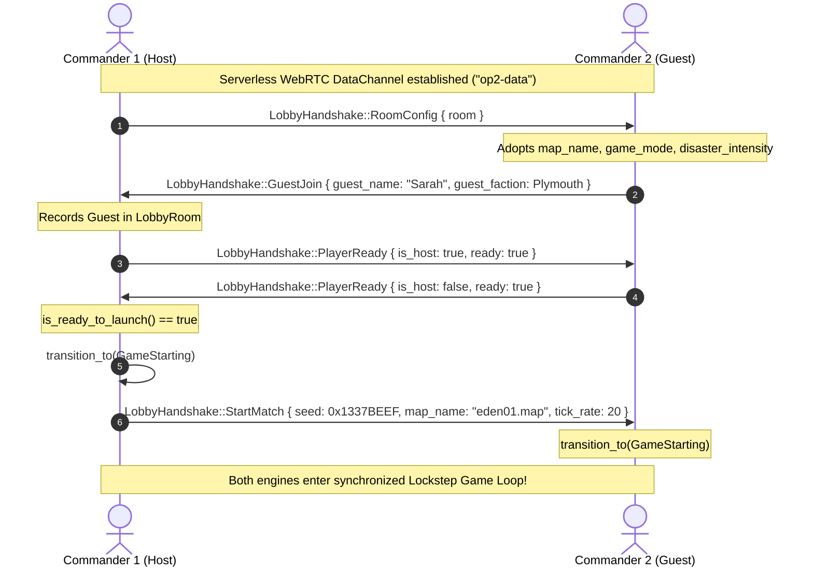

# Outpost 2: Divided Destiny — Save/Load System & Multiplayer Match Lobby Specification

## 1. Overview & Architectural Philosophy

The survival simulation of *Outpost 2: Divided Destiny* requires robust state persistence and seamless real-time matchmaking. Because colonies on New Terra take hours of tactical maneuvering, ore extraction, scientific research, and defense against catastrophic natural disasters, the engine guarantees **loss-free simulation persistence** across browser sessions and across devices.

### Core Tenets:
1. **Full-Fidelity State Snapshots:** Serializing and restoring a game state recreates the exact state of every colonial resource, building, mobile vehicle, disaster front, mission objective, and dynamic scripting trigger down to the exact tile and tick.
2. **Decoupled Metadata Indexing:** `SaveMetadata` provides instantaneous slot listing, timestamps, colony duration, and faction recognition without incurring the overhead of deserializing heavy simulation payloads.
3. **Dual Persistence Tier:**
   - **Browser LocalStorage Backend:** Rapid, low-latency access to 5 user slots, a dedicated QuickSave slot (`F5`), and milestone AutoSaves (every 100 Sols).
   - **Standalone File Export Backend (`.op2save`):** Encapsulated, compressed Base64/JSON archives that players can download, back up, share, or import on any machine.
4. **Serverless Match Lobby State Machine:** Multiplayer skirmish sessions coordinate room configuration, map selection, environmental intensity, and player readiness over serverless WebRTC data channels before the lockstep simulation engine starts.

---

## 2. Save Game Architecture & Schemas

### 2.1 Metadata Descriptor (`SaveMetadata`)

`SaveMetadata` is stored alongside each save slot to enable fast UI indexing in the save/load menu without parsing entire game states.

```rust
#[derive(Debug, Clone, PartialEq, Eq, Serialize, Deserialize)]
pub struct SaveMetadata {
    pub slot: u32,
    pub name: String,
    pub timestamp_utc: u64,
    pub faction: Faction,
    pub sol: u32,
    pub scenario_name: String,
    pub playtime_seconds: u32,
}
```

| Field | Type | Description |
|---|---|---|
| `slot` | `u32` | Slot number (1..=5 for user slots, 0 for QuickSave, 100 for AutoSave). |
| `name` | `String` | User-defined or auto-generated save designation. |
| `timestamp_utc` | `u64` | Epoch timestamp in seconds when the save was created. |
| `faction` | `Faction` | Colony allegiance (`Eden` or `Plymouth`). |
| `sol` | `u32` | Planetary Sol count at time of persistence. |
| `scenario_name` | `String` | Scenario name or operation codename. |
| `playtime_seconds` | `u32` | Total cumulative gameplay time in seconds. |

---

### 2.2 Comprehensive State Snapshot (`SaveGameState`)

`SaveGameState` holds the exhaustive simulation state.

```rust
#[derive(Debug, Clone, PartialEq, Serialize, Deserialize)]
pub struct SaveGameState {
    pub metadata: SaveMetadata,
    pub resources: ColonyResourcesSave,
    pub structures: Vec<StructureSaveState>,
    pub units: Vec<UnitSaveState>,
    pub disasters: DisasterSaveState,
    pub mission: MissionSaveState,
    pub event_engine: EventEngineSaveState,
    pub tubes: Vec<(i32, i32)>,
    pub day_cycle: f64,
}
```

#### Component Breakdown:

#### 1. Colony Resources (`ColonyResourcesSave`)
Captures all stockpiles, energy grid output/consumption, and researched technologies:
- `common_ore: u32`: Common metals extracted for structures and armor.
- `rare_ore: u32`: High-grade metals for advanced electronics and weapons.
- `food: u32`: Bio-dome hydroponic sustenance units.
- `morale: u32`: Morale percentage (0–100%) governing colony productivity tiers.
- `population: u32`: Total surviving colonists.
- `power_produced: u32`: Aggregate output from Tokamaks, Geothermals, and Solar Arrays.
- `power_consumed: u32`: Energy drain from active facilities and life-support domes.
- `starship_progress: f64`: Starship evacuation module assembly completion (0–100%).
- `tech_progress: Vec<u32>`: Unique IDs of all completed research topics in the tech matrix.

#### 2. Colonial Structures (`StructureSaveState`)
Full state of every deployed building and defense turret:
- `id: u32`: Unique persistent facility identifier.
- `type: StructureType`: Facility type (`CommandCenter`, `SolarArray`, `TokamakReactor`, `CommonOreSmelter`, `RareOreSmelter`, `DirtLab`, `StandardLab`, `Residence`, `Agrodome`, `VehicleFactory`, `RepairFacility`, `GuardPost`, `GeothermalPlant`, `Spaceport`).
- `x: i32`, `y: i32`: Isometric tile anchor coordinates.
- `hp: u32`, `max_hp: u32`: Structural integrity and damage threshold.
- `enabled: bool`: Operational power switch.
- `power_status: PowerStatus`: Grid power receipt (`Powered`, `Unpowered`, `Disabled`).
- `faction: Option<Faction>`: Owning colony allegiance.
- `production_queue: Vec<String>`: Vehicle or structure kit assembly queue.
- `production_progress: f64`: Assembly progress of active item.
- `attack_cooldown: f64`: Defensive turret weapon recycle timer.

#### 3. Tactical Mobile Units (`UnitSaveState`)
Full state of all ground vehicles, haulers, combat tanks, and construction equipment:
- `id: u32`: Unique unit identifier.
- `type: UnitType`: Chassis type (`CargoTruck`, `ConVec`, `RepairVehicle`, `Earthworker`, `Lynx`, `Panther`, `Tiger`, `RoboMiner`, `EvacuationTransport`).
- `x: i32`, `y: i32`: Current tile coordinates.
- `hp: u32`, `max_hp: u32`: Chassis armor hit points.
- `direction: Direction8`: 8-way compass heading (`North`, `NorthEast`, `East`, `SouthEast`, `South`, `SouthWest`, `West`, `NorthWest`).
- `order: UnitOrder`: Active tactical order (`Idle`, `MoveTo`, `Attack`, `Repair`, `MineOre`, `DeployStructure`, `BuildWall`, `BuildTube`, `ClearHazard`, `Bulldoze`, `Guard`, `Patrol`).
- `cargo: Option<(OreType, u32)>`: Hauled common or rare ore payload.
- `weapon: Option<WeaponType>`: Mounted turret armaments (`Laser`, `Microwave`, `Railgun`, `RPG`, `EMP`).
- `hauler_state: Option<HaulerState>`: Automated freight route state (`DrivingToMine`, `Loading`, `DrivingToSmelter`, `Unloading`).
- `cargo_kit: Option<String>`: ConVec structure kit payload.

#### 4. Natural Disasters & Dynamic Hazards (`DisasterSaveState`)
The state of planetary environmental threats:
- `active_lava_flows: Vec<(u32, u32)>`: Active volcanic magma coordinates burning across the surface.
- `vortices: Vec<AtmosphericVortex>`: Rotary dust vortices (position, velocity, radius, lifetime).
- `meteors: Vec<MeteorImpact>`: Descending orbital kinetic impactors (delay timer, impact site, radius).
- `active_blight_tiles: Vec<(u32, u32)>`: Microbial Blight biogenic spore contamination.
- `sol_timer: f64`: Disaster cycle clock.

#### 5. Mission State (`MissionSaveState`)
Campaign scenario progress:
- `objectives: Vec<Objective>`: Primary and secondary directives and their status (`Pending`, `Active`, `Completed`, `Failed`).
- `casualties: u32`: Cumulative colonist casualties.
- `timer: f64`: Mission elapsed clock.
- `status: MissionStatus`: `InProgress`, `Victory`, or `Defeat`.

#### 6. Dynamic Scripting Engine (`EventEngineSaveState`)
Preserves reactive trigger state machines:
- `triggers: Vec<ScriptTrigger>`: All script triggers, including whether they have fired, repeatability, cooldown counters, and last fired ticks.
- `notifications: Vec<TacticalNotification>`: Historical tactical HUD advisories.
- `current_tick: u32`: Engine event tick counter.

---

## 3. Storage Backends & Workflows

### 3.1 LocalStorage Persistence Matrix

The `LocalStorageBackend` leverages `web_sys::window().local_storage()` to provide persistent slots in the browser sandbox.

| Slot | Storage Key | Metadata Key | Purpose |
|---|---|---|---|
| `0` | `op2_save_quicksave` | `op2_save_quicksave_meta` | Dedicated QuickSave (`F5`) / QuickLoad (`F9`). |
| `1` | `op2_save_slot_1` | `op2_save_slot_1_meta` | User Slot 1. |
| `2` | `op2_save_slot_2` | `op2_save_slot_2_meta` | User Slot 2. |
| `3` | `op2_save_slot_3` | `op2_save_slot_3_meta` | User Slot 3. |
| `4` | `op2_save_slot_4` | `op2_save_slot_4_meta` | User Slot 4. |
| `5` | `op2_save_slot_5` | `op2_save_slot_5_meta` | User Slot 5. |
| `100` | `op2_save_autosave` | `op2_save_autosave_meta` | Automated Milestone AutoSave (every 100 Sols). |



---

### 3.2 Standalone `.op2save` File Export/Import Format

The `FileExportBackend` generates cross-platform portable `.op2save` files.

#### Format Structure:
```
OP2SAVE-V1:<Base64-encoded UTF-8 Minified JSON>
```

#### Example Payload:
```
OP2SAVE-V1:eyJtZXRhZGF0YSI6eyJzbG90IjoxLCJuYW1lIjoiQ29sb255IEJldGEiLCJ0aW1lc3RhbXBfdXRjIjoxNzMwMDAwMDAwLCJmYWN0aW9uIjoiRWRlbiIsInNvbCI6MTI0LCJzY2VuYXJpb19uYW1lIjoiT3BlcmF0aW9uIE5ldyBEYXduIiwicGxheXRpbWVfc2Vjb25kcyI6MTg0MH0sInJlc291cmNlcyI6...
```

#### Resilient Ingestion:
`FileExportBackend::import_from_op2save` accepts:
1. Standard headered Base64 strings (`OP2SAVE-V1:...`)
2. Raw Base64 strings without prefix
3. Direct unencoded JSON strings

#### Download Triggering:
On WASM targets, `FileExportBackend::trigger_download` creates an HTML `<a>` element with a `data:application/octet-stream;base64,...` URL, sets the `download` attribute to `outpost2_{faction}_sol{sol:04}_slot{slot}.op2save`, appends it to DOM, fires `.click()`, and cleans up.

---

## 4. Multiplayer & Skirmish Match Lobby Subsystem

### 4.1 Lobby State Machine (`LobbyState`)

The match lobby coordinates room configuration, faction choices, and simulation seed parity before starting the lockstep game loop.



### 4.2 Lobby Room Configuration (`LobbyRoom`)

```rust
#[derive(Debug, Clone, PartialEq, Eq, Serialize, Deserialize)]
pub struct LobbyRoom {
    pub room_id: String,
    pub host_name: String,
    pub map_name: String,
    pub faction: Faction,
    pub game_mode: GameMode,
    pub disaster_intensity: u32,
    pub starting_resources: u32,
    pub guest_name: Option<String>,
    pub guest_faction: Option<Faction>,
    pub state: LobbyState,
    pub is_host_ready: bool,
    pub is_guest_ready: bool,
    pub match_seed: u64,
}
```

- **`game_mode`:** `Campaign` (narrative mission), `Skirmish` (multi-AI free-for-all), or `P2P` (player-vs-player tactical duel).
- **`disaster_intensity`:** `0` (None), `1` (Mild tremors), `2` (Standard volcanic calderas), `3` (Extreme cataclysm with multiple vortices and meteor storms).
- **`starting_resources`:** Initial common and rare metal allowances (e.g. 3,000 to 10,000 tonnes).
- **`match_seed`:** 64-bit seed (`0xDEADBEEF`, `0x1337BEEF`) ensuring identical pseudo-random number generator outputs on both peers.

---

### 4.3 Lobby Handshake Protocol (`LobbyHandshake`)

Handshake messages travel across the reliable, ordered `RTCDataChannel` ("op2-data") negotiated by `WebRtcSession`.

```json
{
  "type": "RoomConfig",
  "room": {
    "room_id": "NEW-TERRA-42",
    "host_name": "Commander Vance",
    "map_name": "eden01.map",
    "faction": "Eden",
    "game_mode": "P2P",
    "disaster_intensity": 2,
    "starting_resources": 4000,
    "guest_name": null,
    "guest_faction": null,
    "state": "Connected",
    "is_host_ready": false,
    "is_guest_ready": false,
    "match_seed": 3735928559
  }
}
```

#### Protocol Message Variants:
1. **`RoomConfig { room: LobbyRoom }`:** Transmitted by the Host immediately upon data channel establishment. Communicates map, game mode, disaster settings, and initial parameters.
2. **`GuestJoin { guest_name: String, guest_faction: Faction }`:** Transmitted by the Guest upon receiving `RoomConfig`. Confirms identity and chosen faction.
3. **`PlayerReady { is_host: bool, ready: bool }`:** Broadcast whenever a commander checks or unchecks the tactical readiness indicator.
4. **`StartMatch { seed: u64, map_name: String, tick_rate: u32 }`:** Issued exclusively by the Host once both players are ready. Triggers transition to `GameStarting` and loads the map on both peers.
5. **`LobbyChat { sender: String, text: String, timestamp_secs: f64 }`:** In-lobby tactical chatter between commanders.

#### Handshake Sequence Flow:


---

## 5. Testing & Verification

Comprehensive automated test coverage in `src/sim/save.rs` and `src/net/lobby.rs` verifies:
- Complete roundtrip serialization and deserialization of `SaveMetadata`.
- Complete deep equality preservation of all colony state attributes (stockpiles, tech progress, buildings, units, paths, hauler states, disasters, objectives, casualties, and triggers).
- `.op2save` file export with standard header prefix and multi-format decoding resilience.
- LocalStorage slot key generation and slot range bounds enforcement.
- Milestone autosave calculation every 100 Sols.
- Hotkey dispatch and execution for QuickSave (`F5`) and QuickLoad (`F9`).
- Match lobby instantiation, transition validation, handshake serde roundtrips, and launch readiness evaluation.
