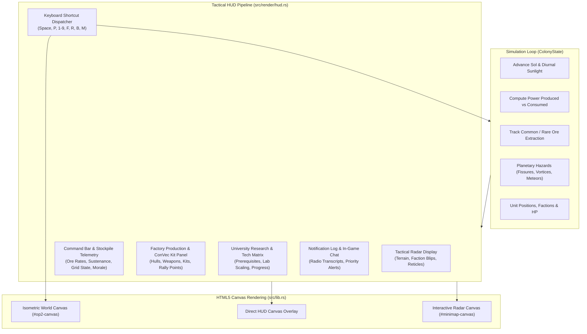
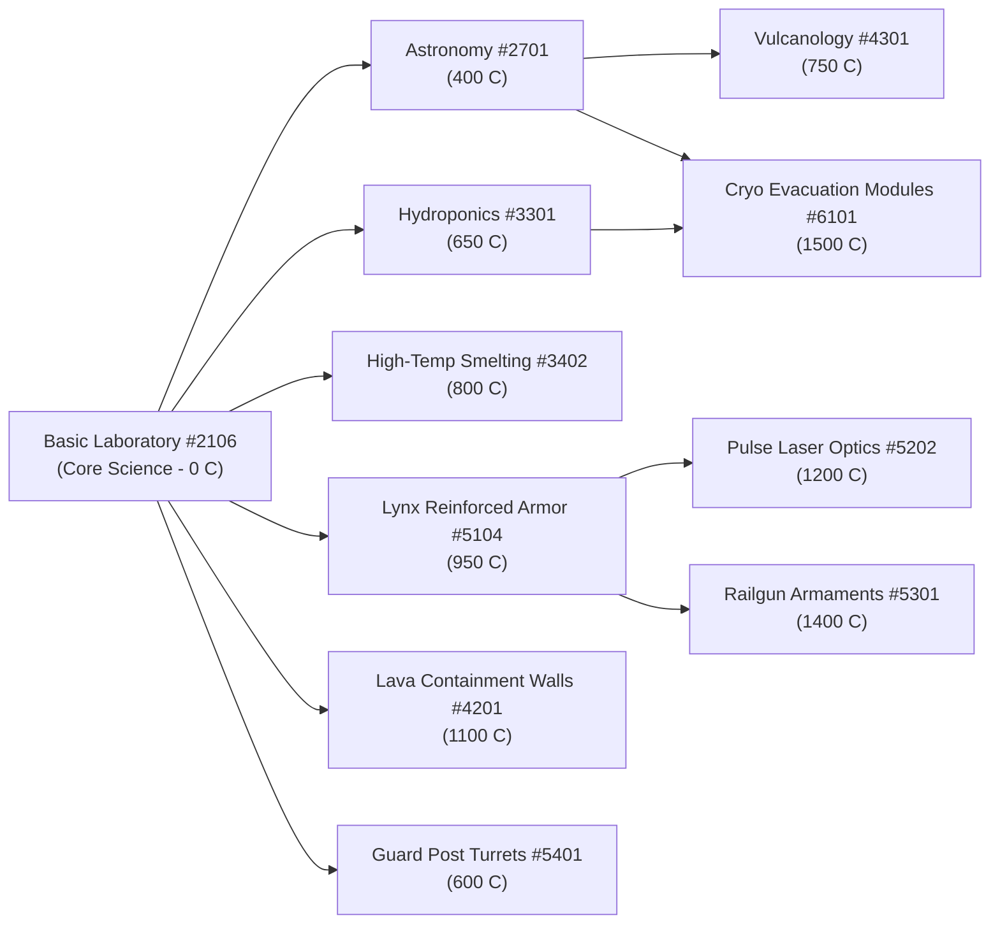

# Outpost 2 — Modern WebHUD & Tactical Command Dashboard Architecture

## 1. Overview & Architecture

The Outpost 2 native Rust/WASM port implements an authentic tactical Heads-Up Display (HUD) and command dashboard (`src/render/hud.rs`). The subsystem mirrors the visual aesthetic, color palette, telemetry readouts, and operational ergonomics of Sierra On-Line's 1997 *Outpost 2: Divided Destiny*, augmented for modern high-resolution desktop and browser displays.

The architecture decouples UI state, simulation telemetry, camera projection mathematics, and interactive canvas rendering into modular components:



---

## 2. Tactical Minimap Radar Display

The tactical radar display provides a miniaturized strategic overview of the entire New Terra theater of operations.

```
+--------------------------------------------------------------+
| TACTICAL RADAR                                    [DETAIL: ON]|
| +----------------------------------------------------------+ |
| | . . . . . . . . . . . . . . . . . . . . . . . . . . . .  | |
| | . . . . . . . [E] . . . . . . . . . . . . . . . . . . .  | |
| | . . . . . . [===] . . . . . . . . ( * ) Meteor Impact    | |
| | . . . . . . . | . . . . . . . . . . . . . . . . . . . .  | |
| | . . . . . . [===]===+--[Camera Frustum Rect]--+ . . . .  | |
| | . . . . . . . . . . |   [Eden Tank (Blue)]    | . . . .  | |
| | . . ( ~ ) Vortex .  |                         | . . . .  | |
| | . . . . . . . . . . +-------------------------+ . . . .  | |
| | . . . . . . . . . . . . . . . . . . . . . . . . . . . .  | |
| | . . . . . . . . . . . . . . . . . . [Plymouth (Red)] . . | |
| | . . . . . . . . . . . . . . . . . . . . . . . . . . . .  | |
| +----------------------------------------------------------+ |
| Left-Click / Drag: Pan Viewport | Right-Click: Set Rally Point|
+--------------------------------------------------------------+
```

### 2.1 Miniaturized Terrain & Fog of War
- Maps are rendered tile-by-tile scaled to minimap dimensions `(radar_width, radar_height)`.
- Explored areas render in muted gunmetal `#1e293b`.
- Currently visible tiles (within unit/structure sensor radii) illuminate in bright slate `#334155`.
- Unexplored tiles remain deep void `#030712`.

### 2.2 Faction Unit Color-Coding
Units are rendered as high-contrast blips according to faction allegiance:
- **Eden Units**: Tactical Cyan / Blue (`#38bdf8`)
- **Plymouth Units**: Hostile Crimson / Red (`#ef4444`)
- **Neutral Beacons & Ore Deposits**: Amber / Yellow (`#facc15`)
- **Colonial Structures**: Structural Cyan outlines (`#38bdf8`)
- **Transport Tubes**: Reinforced conduit gray (`#64748b`)

### 2.3 Planetary Disaster Radar Blips
- **Volcanic Fissures & Lava Channels**: Pulsing orange/red blips (`rgba(249, 115, 22, α)`) modulated with a sinusoidal alpha frequency ($0.5 + 0.5 \cdot |\sin(8 \cdot \text{sol})|$).
- **Atmospheric Vortices**: Rotating dual-arc yellow swirling glyphs (`#fde047`) rotating continuously with Sol time.
- **Incoming Meteor Impact Sites**: Circular targeting reticles (`#ef4444`) with targeting crosshairs centered over the projected ground strike coordinates.
- **Rally Points**: Green crosshair markers (`#4ade80`) designating automated assembly points.

### 2.4 Frustum Projection & Interactive Click-to-Pan
The camera bounding rectangle projects the 4 corners of the viewport back into isometric map coordinates using inverse matrix math:

$$\begin{aligned}
\text{rel}_x &= \frac{s_x - \text{camera}_x}{\frac{1}{2} \cdot \text{tile}_w \cdot \text{zoom}} \\
\text{rel}_y &= \frac{s_y - \text{camera}_y}{\frac{1}{2} \cdot \text{tile}_h \cdot \text{zoom}} \\
t_x &= \frac{\text{rel}_y + \text{rel}_x}{2}, \quad t_y = \frac{\text{rel}_y - \text{rel}_x}{2}
\end{aligned}$$

Minimap clicks compute camera offsets such that the designated tile $(t_x, t_y)$ is centered on screen:

$$\begin{aligned}
\text{camera}_x &= \frac{\text{screen}_w}{2} - (t_x - t_y) \cdot \frac{\text{tile}_w}{2} \cdot \text{zoom} \\
\text{camera}_y &= \frac{\text{screen}_h}{2} - (t_x + t_y) \cdot \frac{\text{tile}_h}{2} \cdot \text{zoom}
\end{aligned}$$

---

## 3. Colony Command Dashboard & Resource Status Bar

The status bar sits across the upper perimeter of the viewport (`rgba(11, 15, 23, 0.94)`) and renders live colonial vital signs:

| Telemetry Element | Visual Representation | Calculation & Semantics |
|---|---|---|
| **Faction Badge** | Cyan `EDEN` or Crimson `PLYMOUTH` | Player allegiance |
| **Sol Timer** | `SOL: 1.04` (white/slate) | Planetary diurnal cycle counter |
| **Common Ore** | Amber `2,450 t (+45/s)` | Ore stockpile and net production delta per Sol |
| **Rare Ore** | Purple `680 t (+15/s)` | Refined rare metals stockpile and net delta |
| **Food & Sustenance** | Green/Amber `1,400 [Surplus]` | Population consumption vs stockpile adequacy (`Surplus`, `Adequate`, `Rationing`, `STARVATION`) |
| **Power Grid** | `450/380 MW` | Operational energy grid balance (`NORMAL`, `BROWNOUT`, `BLACKOUT`) |
| **Colony Morale** | `98% - Excellent` | Morale level tiers based on living standards and casualties |

### 3.1 Energy Grid Operational States
- **Normal** ($\text{Power}_{\text{produced}} \ge \text{Power}_{\text{required}}$): Indicator glows `#22c55e` (`GRID OPTIMAL`).
- **Brownout** ($\text{Power}_{\text{produced}} < \text{Power}_{\text{required}}$ with deficit $< 50\%$): Amber `#f59e0b` (`BROWNOUT ALERT`). Non-essential structures operate at reduced efficiency.
- **Blackout** ($\text{Power}_{\text{produced}} = 0$ or deficit $\ge 50\%$): Flashing crimson `#ef4444` (`BLACKOUT CRITICAL`). Production facilities and radar arrays go offline.

### 3.2 Morale Gauge Classification
- **Excellent** ($90\% - 100\%$): High immigration and research speed bonus (`#4ade80`).
- **Good** ($75\% - 89\%$): Stable population and standard productivity (`#a3e635`).
- **Fair** ($50\% - 74\%$): Minor unrest warning (`#facc15`).
- **Poor** ($25\% - 49\%$): Significant unrest; factory production slowdown (`#fb923c`).
- **Rioting** ($< 25\%$): Colonists strike, sabotaging infrastructure and abandoning the settlement (`#ef4444`).

---

## 4. Factory Production & ConVec Kit Queue Panel

Toggled with key **`F`** or via the construction bar, the factory panel orchestrates vehicle fabrication, weapon loadouts, modular construction kits, and automated rally-point routing.

### 4.1 Vehicle Chassis Hulls (`VehicleHull`)
- **Lynx Scout**: Fast light reconnaissance chassis (140 HP, 140 Common Ore)
- **Panther Battle Tank**: Medium combat armor (250 HP, 250 C, 50 R)
- **Tiger Heavy Tank**: Heavy assault armored chassis (420 HP, 350 C, 100 R)
- **Cargo Truck**: High-capacity ore hauler (150 HP, 150 Common Ore)
- **ConVec Transport**: Specialized modular construction kit carrier (180 HP, 150 Common Ore)
- **Robo-Miner**: Subterranean mineral extractor (200 HP, 200 C, 40 R)
- **Robo-Surveyor**: High-speed exploration and beacon analysis unit (130 HP, 130 C, 10 R)
- **Earthworker**: Fortification, conduit tube, and hazard mitigation vehicle (200 HP, 160 Common Ore)

### 4.2 Weapon & Attachment Selection
- **Pulse Laser**: High-energy direct-fire beam weapon (Standard loadout)
- **Microwave Emitter**: Thermal emitter penetrating enemy vehicle armor (Requires Research 5202)
- **Hyper-Velocity Railgun**: Heavy kinetic sabot accelerator (Requires Research 5301)
- **Rocket Pod (RPG)**: High-explosive missile salvo for long-range engagements
- **Acid Cloud Dispenser**: Chemical corrosive payload dissolving armor plates

### 4.3 Modular ConVec Kits (`KitAttachment`)
ConVecs can be commissioned pre-loaded with colonial structure kits:
- Common Ore Smelter, Solar Array, Tokamak Fusion Reactor, Geothermal Plant, Bio-Dome (Agrodome), Guard Post Turret, Colonial Residence, D.I.R.T. Lab, Standard Lab, Repair Depot, Vehicle Factory, Starship Gantry.

### 4.4 Queue Management & Rally Points
- **Affordability Validation**: Verifies Common and Rare ore balances before enqueuing.
- **Refund Policy**: Canceling an order refunds 100% of invested resources.
- **Rally Point**: Manufactured units immediately receive automated travel orders to the assigned tactical rally coordinates upon rollout.

---

## 5. University Research & Tech Tree Browser

Toggled with key **`R`**, the scientific matrix displays the colonial technology graph, prerequisites, research costs, and live progress bars.



### Research Advancement Dynamics:
- **Prerequisite Validation**: Locked nodes indicate missing research requirements.
- **Laboratory Throughput**: Progress rates scale linearly with the number of operational laboratories:

$$\text{Rate} = 12.0\% \cdot \min(\text{Active Labs}, 4) \quad \text{per second}$$

- **Completion Dispatch**: When progress reaches 100%, the new discipline is recorded into `TechTree`, granting immediate structural and military bonuses across the colony.

---

## 6. Tactical Notification Dispatcher & In-Game Chat HUD

The lower-left quadrant of the screen houses the scrolling notification feed.

### 6.1 Priority Classifications
- **Low `[INFO]`** (`#38bdf8`): Scientific completions, building deployments, routine status.
- **Medium `[CAUTION]`** (`#facc15`): Low power warning, minor tremors, ore depot depleted.
- **High `[WARNING]`** (`#fb923c`): Approaching vortex, magma fissure eruption, brownout alert.
- **Critical `[CRITICAL]`** (`#ef4444`): Hostile Plymouth incursion, base under attack, meteor strike incoming.

### 6.2 Location Tagging & Jump-to-Alert
High and critical notifications record their map origin coordinates $(x, y)$. Pressing **`Space`** immediately shifts the camera frustum directly over the affected zone.

### 6.3 In-Game & Multiplayer Chat
Transmissions from allied and rival commanders via WebRTC peer channels appear formatted with channel badges, caller identification, and Sol timestamps:
`[Radio] [Player 2]: Plymouth forces sighted entering southern pass!`

---

## 7. Responsive Keyboard Shortcut Reference

| Key / Hotkey | Action Dispatch | Description |
|---|---|---|
| **`Space`** | `JumpToLastAlert` | Center viewport on the origin of the most recent alert/disaster |
| **`P`** | `TogglePause` | Pause / resume the simulation tick loop |
| **`Ctrl + 1-9`** | `AssignControlGroup(N)` | Bind all currently selected units to squad group $N$ ($1 \dots 9$) |
| **`1-9`** | `RecallControlGroup(N)` | Select squad group $N$; double-press focuses camera on squad |
| **`F`** | `ToggleFactoryView` | Open or dismiss the Factory Production & ConVec Kit panel |
| **`R`** | `ToggleResearchView` | Open or dismiss the Scientific Research Matrix modal |
| **`B`** | `JumpToBaseOverview` | Center viewport camera over the colony Command Center |
| **`M`** | `ToggleMinimapDetail` | Toggle radar coordinate grid lines and structural annotations |
| **`WASD` / `Arrows`** | Viewport Panning | Scroll camera smoothly across New Terra |
| **`+` / `-`** | Camera Zoom | Zoom in ($1.15\times$) or out ($0.85\times$) between $0.4\times$ and $2.5\times$ |
| **`Escape`** | Cancel / Close | Cancel ghost placement, abort orders, and close open HUD panels |

---

## 8. Integration & Verification

All UI structures, projection algorithms, and hotkey bindings are verified through automated unit tests in `src/render/hud.rs`:
- `test_radar_projection_conversions`: Invertible mapping between tile grid coordinates and radar pixel space.
- `test_radar_camera_pan_math`: Exact centering of camera on clicked minimap pixels.
- `test_energy_grid_states`: Correct classification of Normal, Brownout, and Blackout states.
- `test_morale_tiers`: Accurate percentage mapping to Excellent, Good, Fair, Poor, and Rioting tiers.
- `test_factory_production_queue_and_cancellation`: Resource deduction, queue FIFO, and 100% cancellation refunding.
- `test_tech_browser_prerequisites`: Strict prerequisite validation preventing locked technology activation.
- `test_hotkey_dispatch`: Deterministic parsing of Space, P, F, R, B, M, and numeric squad groups.
- `test_notification_dispatcher_and_jump`: Insertion, aging, and retrieval of priority alerts with coordinate tracking.
