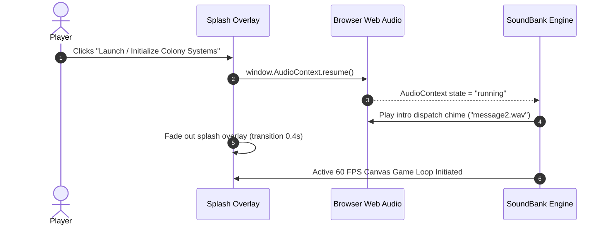

# Outpost 2: Divided Destiny — WebAssembly Packaging & Web Runtime Architecture

## 1. Overview
The modernized port of *Outpost 2: Divided Destiny* is engineered for zero-dependency, standalone execution across all modern desktop and mobile browsers using Rust compiled to **WebAssembly (wasm32-unknown-unknown)**, rendered through HTML5 Canvas with hardware acceleration, and driven by the Web Audio API.

---

## 2. High-DPI Retina Display Scaling

Modern 4K, 5K, and mobile displays feature device pixel ratios ($\text{DPR}$) between $1.5$ and $3.0$. Rendering canvas elements at CSS pixel dimensions results in blurry, interpolated upscaling. The runtime utilizes `compute_high_dpi_canvas_dimensions`:

$$\text{Internal Buffer Width} = \lfloor \text{Client Width} \times \text{DPR} \rfloor$$
$$\text{Internal Buffer Height} = \lfloor \text{Client Height} \times \text{DPR} \rfloor$$

The 2D context is scaled by `(DPR, DPR)` while CSS styles constrain the element to `100vw x 100vh`, ensuring sharp, crisp pixel-art lines and isometric geometry.

---

## 3. Web Audio API Initialization & Gesture Unlocking

Modern browsers strictly enforce autoplay policies that suspend `AudioContext` until an explicit user gesture:



---

## 4. Mobile & Touch Ergonomics

The touch subsystem (`src/render/touch.rs`) maps native touch events to RTS commands:
- **Single-Finger Tap**: Unit selection, building placement confirm, rally point dispatch.
- **Two-Finger Drag**: Fluid directional camera panning across isometric terrain.
- **Two-Finger Pinch**: Real-time zoom in / zoom out ($0.5\times \dots 2.5\times$).
- **Long-Press (> 500ms)**: Contextual orders (patrol waypoint, area guard, attack-move).

---

## 5. Standalone Release Bundle Compilation

Building the final release package utilizes `trunk`:

```bash
trunk build --release
```

Optimization flags configured in `Cargo.toml`:
```toml
[profile.release]
opt-level = 3
lto = true
codegen-units = 1
panic = "abort"
```

The compiled output in `dist/` consists of:
- `index.html`: Fully self-contained web shell with responsive layout and retro Outpost 2 palette.
- `outpost2-*.js`: `wasm-bindgen` glue code and DOM event listeners.
- `outpost2-*_bg.wasm`: Optimized WebAssembly binary (~1.9 MB) bundling all game simulation logic, pathfinding, AI, networking, and preloaded audio samples.
